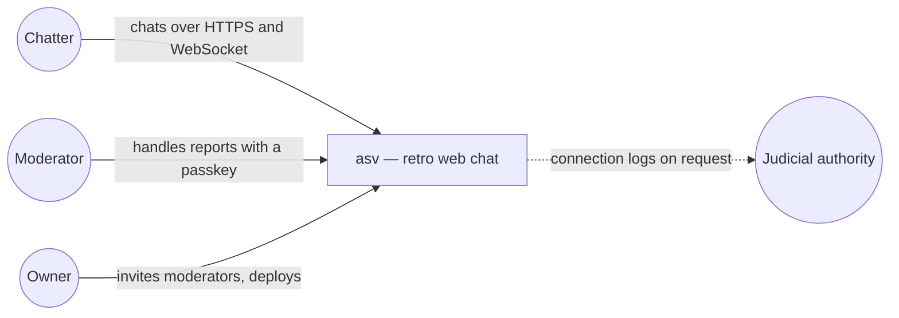
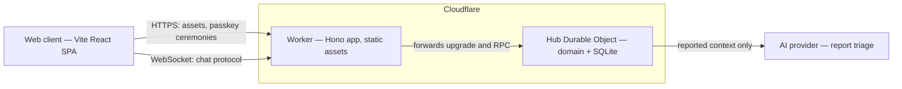

# asv — architecture (arc42 overview)

## 1. Introduction and goals

asv is a retro web chat in the spirit of Caramail: pseudo only, pink/blue/grey pseudos, public rooms,
private windows between strangers, adults only. Product context: [vision](../product/vision.md),
[personas](../product/personas.md), [journeys](../product/journeys.md),
[roadmap](../product/roadmap.md).

Top quality goals (see [requirements](requirements-matrix.md)):

1. **Instant and simple**: chatting less than 30 s after landing (ASV-F-001).
2. **Safe**: adults only, ignore, report, human moderation (ASV-F-002, F-010 to F-016).
3. **Light on data and cost**: free hosting tier, minimal persistence (ASV-NF-003, NF-008).
4. **Portable and testable**: same domain on Node and Cloudflare (ASV-NF-009, NF-010).

## 2. Constraints

- Solo owner, free hosting (Cloudflare Workers Free plan).
- French law and GDPR: LCEN connection logs, DSA notice-and-action (see
  [security and GDPR](security-and-rgpd.md)).
- **No conception, no code**: every implementation follows a validated study (`CLAUDE.md`).

## 3. Context (C4 level 1)

## 4. Solution strategy

- Pure TypeScript domain, two transports (ADR-0002), flat package (ADR-0003).
- One hub holds all live state (ADR-0007). One WebSocket per chatter.
- Session-first identity (ADR-0005), 5-minute away grace (ADR-0009), passkeys for moderators (ADR-0008).
- Hub state rebuilt from socket attachments and minimal away records after hibernation (ADR-0011).
- AI triages reported content only, humans decide (ADR-0010).

## 5. Building blocks (C4 level 2 — containers)

Component level per feature lives in the studies below.

## 6. Feature studies (UML)

| Feature | Use cases | Folder |
|---|---|---|
| Entry and session | UC1, UC10, UC13 | [entry](diagrams/entry/) |
| Rooms | UC2, UC3, UC4, UC5 | [rooms](diagrams/rooms/) |
| Private conversations | UC6, UC8 | [private-conversations](diagrams/private-conversations/) |
| Directory | UC7 | [directory](diagrams/directory/) |
| Moderation | UC9, UC11, UC12, UC14, UC15, UC16 | [moderation](diagrams/moderation/) |
| Web UI | screens and navigation | [web-ui](diagrams/web-ui/) |
| Platform | hub, protocol, deployment | [platform](diagrams/platform/) |

Coverage: [traceability matrix](traceability-matrix.md).

## 7. Cross-cutting concepts

- [Business rules](business-rules.md) · [Glossary](glossary.md)
- [Security and GDPR](security-and-rgpd.md) · [Test strategy](test-strategy.md)
- [Design pack](design-pack.md)

## 8. Decisions

| ADR | Decision |
|---|---|
| [0001](decisions/0001-name-and-domain.md) | Name asv, domain asvchat.fr |
| [0002](decisions/0002-stack.md) | Hono, pure domain, Node transport for dev, Durable Objects in production |
| [0003](decisions/0003-flat-single-package.md) | Flat single package |
| [0004](decisions/0004-audience-adults-only.md) | 18+ only, self-declared |
| [0005](decisions/0005-identity-session-first.md) | Session pseudo in V1, accounts in V2 |
| [0006](decisions/0006-pseudo-colours.md) | Pink / blue / grey, gender optional |
| [0007](decisions/0007-single-hub-durable-object.md) | Single Hub Durable Object in production |
| [0008](decisions/0008-moderator-passkeys.md) | Moderators authenticate with passkeys |
| [0009](decisions/0009-reconnection-grace-away.md) | Five-minute reconnection grace with "away" |
| [0010](decisions/0010-ai-report-triage.md) | AI assists moderators by triaging reports only |
| [0011](decisions/0011-hub-state-and-hibernation.md) | Hub state across hibernation, heartbeat and alarms |

## 9. Risks and technical debt

| Risk | Mitigation |
|---|---|
| Harassment between strangers | Ignore, report, moderators, flood limits (BR-021, BR-052). |
| Minors entering despite 18+ | "Seems minor" report reason, expel (ADR-0004). Teen space only in V2 with real age checks. |
| AI provider processes reported content | Neutral labels instead of pseudos, processing agreement, EU processing preferred (ADR-0010). |
| Hub eviction disconnects everyone | Clients reconnect, away records allow resume (ADR-0011). |
| Legal points unverified | Legal check is brick 9, before public launch. |
| Single hub saturation | Measured shard trigger (ADR-0007). |
| Empty rooms at launch kill the vibe | Few official rooms, seeded by the owner's network. |

## 10. Open questions

- Shared protocol types between web and server (`src/shared/` seam), decided in brick 2.
