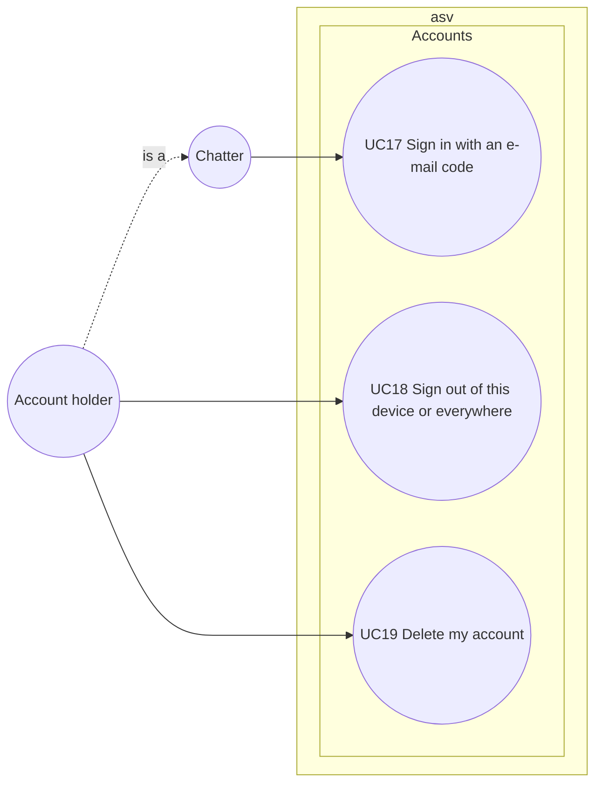

# Use case diagram — accounts — e-mail accounts for private messages

> **Feature**: accounts (roadmap brick 5)
> **Requirements**: ASV-F-020 to F-024
> **Business rules**: BR-070 to BR-080
> **Related ADRs**: ADR-0012, ADR-0013

## Context

How a chatter gets and manages the e-mail account needed for private messages. Does not cover strikes
and suspensions, which moderators apply (see `moderation`), nor the private conversations themselves.

## Diagram

## Use case specs

**UC17 — Sign in with an e-mail code** (planned)
- Primary actor: Chatter. Trigger: wanting to open or answer a private conversation, or the "My account"
  button.
- Preconditions: session connected.
- Success guarantee: the session is linked to an account with a verified e-mail.
- Main scenario:
  1. Chatter types an e-mail address and chooses whether to remember this device.
  2. System checks the format, refuses disposable domains (BR-071), checks the e-mail block list
     (BR-077) and the sending rate (BR-072).
  3. System e-mails a six-digit code valid 10 minutes (BR-070).
  4. Chatter types the code in the chat.
  5. System checks the code, checks the block list again, creates the account if it does not exist and
     links the session to it.
  6. If asked, the client exchanges the returned device claim for a 30-day device cookie (BR-073).
- Extensions:
  - 2a. Disposable domain, blocked e-mail or rate exceeded → refused with the reason.
  - 5a. Wrong code → refused, the fifth wrong try invalidates the code.
  - 5b. Code expired → system offers to send a new one.
  - 5c. The e-mail has a pending strike record from a self-deleted account → the strikes come back (BR-080).
- Alternative start: a chatter entering with a valid device cookie is linked automatically (`entry/02a`).

**UC18 — Sign out of this device or everywhere** (planned)
- Main scenario: 1. Account holder picks "sign out of this device" or "sign out everywhere". 2. System
  deletes the device record(s); signing out of this device also clears the cookie over HTTPS.
  3. Private windows close, the session continues in rooms.
- Mechanism: `POST /account/sign-out` → the Worker hashes the cookie → `rpc signOutDevice(tokenHash)` →
  the hub deletes the record, unlinks every session whose `deviceTokenHash` matches and sends them
  `accountUnlinked`, then the Worker clears the cookie. "Sign out everywhere" goes over the WebSocket
  and calls `deleteAllDevices`.

**UC19 — Delete my account** (planned)
- Main scenario: 1. Account holder picks "delete my account" and confirms. 2. System deletes the account
  and device records. 3. Private windows close, the session continues in rooms.
- Extension: 2a. Active strikes remain → a keyed e-mail hash and the strike expiry dates are kept until
  the last one expires (BR-080).

## Notes

- An account holder is a chatter whose session is linked to an account. Not to be confused with the
  `Member` domain object of `entry/04`, which holds the pseudo.
- There is no password and no profile: the pseudo is still chosen per session.
