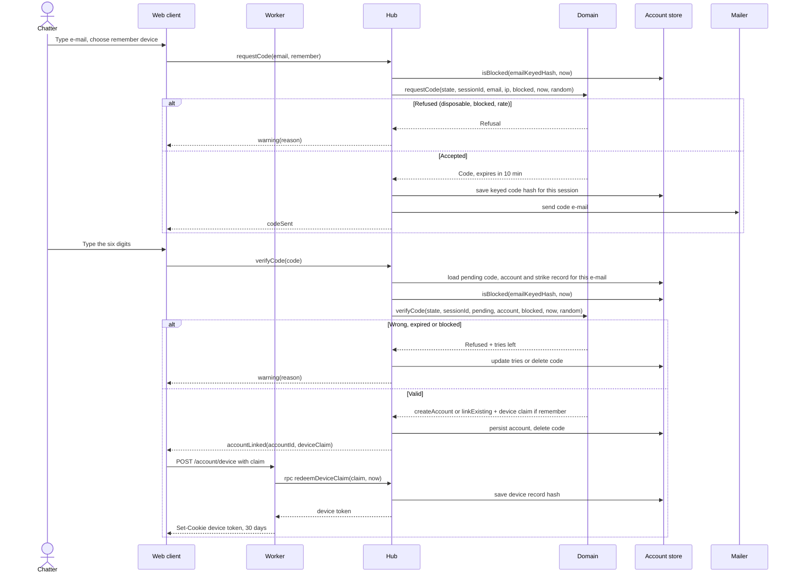

# Sequence diagram — accounts — sign in with an e-mail code

> **Feature**: accounts
> **Use cases**: UC17
> **Business rules**: BR-070 to BR-073, BR-077, BR-080
> **Related ADRs**: ADR-0011, ADR-0013

## Context

From typing an e-mail to a session linked to a verified account, all in the chat tab. Does not cover the
automatic link at entry with an existing device cookie (see `entry/02a`).

## Diagram

## Notes

- The domain decides creation, linking and refusals. The store only persists (dependency rule).
- Codes, claims and device tokens are stored as hashes. A device claim is single use and valid 60 seconds.
- The session keeps the device token hash in its socket attachment so UC18 can sign this device out.
- The e-mail address is never shown to other chatters.
