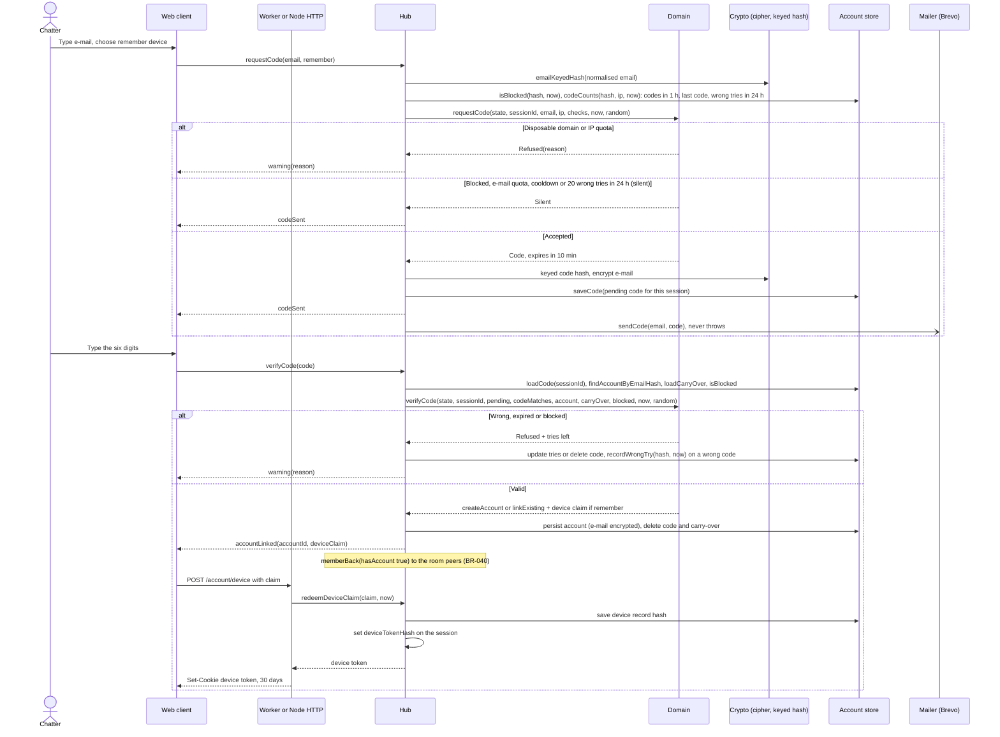

# Sequence diagram — accounts — sign in with an e-mail code

> **Feature**: accounts
> **Use cases**: UC17
> **Business rules**: BR-070 to BR-073, BR-077, BR-080, BR-083
> **Related ADRs**: ADR-0011, ADR-0013, ADR-0017

## Context

From typing an e-mail to a session linked to a verified account, all in the chat tab. Does not cover the
automatic link at entry with an existing device cookie (see `entry/02a`).

## Diagram

## Notes

- The domain decides creation, linking, refusals and the silent answer. The hub computes hashes,
  compares the code in constant time (`codeMatches`) and passes plain booleans; the store only persists
  (dependency rule).
- The mail is sent after `codeSent` is queued, so the response time does not depend on the provider.
  A send failure is logged without the address (ADR-0013 amendment); the chatter can ask for a new code
  after the cooldown.
- Codes, claims and device tokens are stored as hashes. A device claim is single use and valid 60 seconds.
- Stored e-mails are encrypted with the field cipher and looked up by keyed hash (ADR-0017, BR-083).
- The session keeps the device token hash so UC18 can sign this device out.
- The e-mail address is never shown to other chatters.
