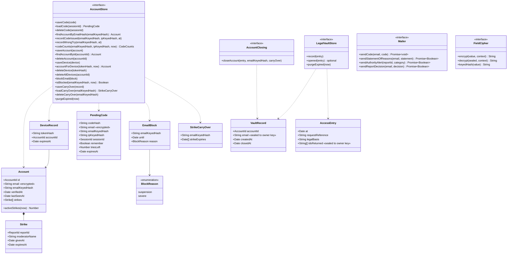

# Class diagram — accounts — accounts, devices, strikes, blocks

> **Feature**: accounts
> **Business rules**: BR-070 to BR-082
> **Related ADRs**: ADR-0012, ADR-0013, ADR-0014, ADR-0017

## Context

Persisted account records and their ports. Does not cover sessions (see `entry`) or reports
(see `moderation`).

## Diagram

## Notes

- «encrypted» fields go through `FieldCipher` (AES-256-GCM, versioned data keys) in the hub before they
  reach a store; «sealed to owner key» fields are encrypted to the owner public key and the application
  cannot read them back (ADR-0017, BR-083). Ids, dates and counters stay clear.
- `Mailer` is the brasse-bouillon `MailerService` port (ADR-0013 amendment): it never throws for
  `sendCode`; `sendStatementOfReasons` returns whether Brevo accepted the mail (BR-076 retries). Brick 8c adds
  `sendAuthorityAlert` (BR-104) and `sendReportDecision` (BR-107), with the same contract.
- `FieldCipher` lives in `src/server/crypto/` (WebCrypto), not in the domain: the domain never sees
  ciphertext or keys. It is drawn here because the stores receive its output.

- `EmailBlock` and `StrikeCarryOver` keep only an HMAC of the e-mail, never the address (BR-077, BR-080).
- The pending statement of reasons (BR-076) lives on `ModerationStore` (`moderation/04`), not here.
- `Session` gains optional `accountId` and `deviceTokenHash` (see `entry/04`).
- One port for all account records is enough: there is one SQLite store and one in-memory twin.
- `LegalVaultStore` is a separate write-only port (ADR-0014, brick 5): `record` and `purgeExpired`, no read
  operation. `createdAt` is `verifiedAt`.
- `AccountClosing.closeAccount` (UC19, BR-081) writes the vault record, deletes the account and its devices
  and saves the carry-over as one store operation, after `AccountIo` has sealed the e-mail. On Cloudflare it
  runs in one SQLite transaction (`storage.transactionSync`), so any failure leaves nothing written. On Node
  the in-memory account store and the file vault share no transaction: the adapter runs the writes in order,
  vault first, so a failed vault write deletes nothing, but a failure after it leaves the vault row and the
  account (a retry then adds a second vault row).
  Optional `opened(entry)`, implemented only by a vault that outlives the account store (file vault of ADR-0018,
  BR-084): `AccountIo.saveAccount` calls it for a created account with the sealed e-mail and `verifiedAt`.
  `purgeExpired` drops `accountId` 1 year and the whole record 5 years after `closedAt`, and also purges access
  entries older than 5 years. Each owner read appends an `AccessEntry` (BR-082). The owner-only read
  is a dedicated hub call outside this port (BR-082).
