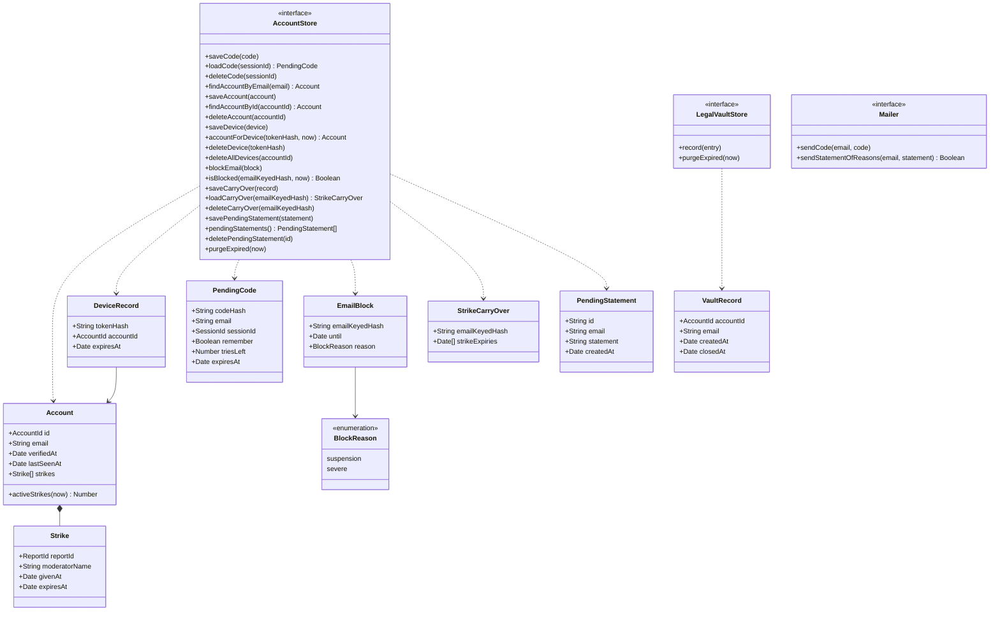

# Class diagram — accounts — accounts, devices, strikes, blocks

> **Feature**: accounts
> **Business rules**: BR-070 to BR-082
> **Related ADRs**: ADR-0012, ADR-0013, ADR-0014

## Context

Persisted account records and their ports. Does not cover sessions (see `entry`) or reports
(see `moderation`).

## Diagram

## Notes

- `EmailBlock` and `StrikeCarryOver` keep only an HMAC of the e-mail, never the address (BR-077, BR-080).
- A `PendingStatement` keeps the address only until the mailer accepts the statement of reasons, then
  is deleted, so the art. 17 notice is not lost if sending fails (retries for at most 7 days).
- `Session` gains optional `accountId` and `deviceTokenHash` (see `entry/04`).
- One port for all account records is enough: there is one SQLite store and one in-memory twin.
- `LegalVaultStore` is a separate write-only port (ADR-0014, brick 5): `record` and `purgeExpired`, no read
  operation. `deleteAccount` and `record` run in the same transaction (BR-081). `createdAt` is `verifiedAt`.
  `purgeExpired` drops `accountId` 1 year and the whole record 5 years after `closedAt`. The owner-only read
  is a dedicated hub call outside this port (BR-082).
