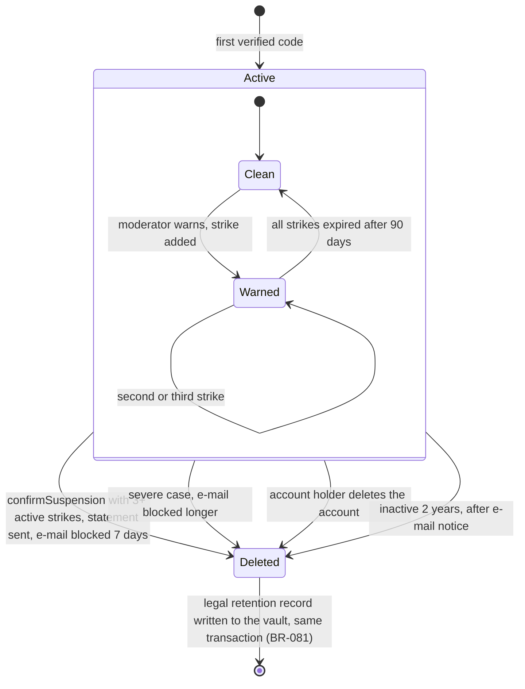

# State diagram — accounts — account lifecycle

> **Feature**: accounts
> **Use cases**: UC17, UC19, UC12, UC11
> **Business rules**: BR-074 to BR-082
> **Related ADRs**: ADR-0012, ADR-0014

## Context

Lifecycle of an account from the first verified code to deletion, including the three-strike path.
Does not cover device records, which expire on their own.

## Diagram

## Notes

- The suspension proposal is not a stored state: the moderator panel offers it whenever an account has
  three or more active strikes and no decision yet (BR-075).
- Every deletion by a moderator sends a statement of reasons by e-mail first (DSA art. 17, BR-076).
- Self-deletion with active strikes keeps a strike carry-over record (BR-080).
- Deleting the account removes it from the account store. Keyed hashes remain until they expire, and the
  vault keeps the account id 1 year and the e-mail and dates 5 years, then the daily purge removes them
  (BR-081). Nothing in the domain reads the vault (BR-082).
