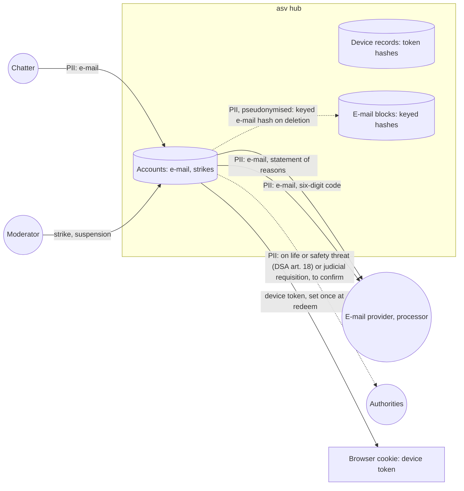

# Data-flow diagram — accounts — e-mail and sanctions

> **Feature**: accounts
> **Related**: `docs/architecture/security-and-rgpd.md` §2, ADR-0012, ADR-0013

## Context

Where e-mail addresses and account data go. Does not cover reports (see `moderation`).

## Diagram

## Notes

- Other chatters never see the e-mail.
- Retention values are proposals until the brick 1 bis legal check (BR-078, BR-079). The 7-day block of BR-077 is an owner decision.
