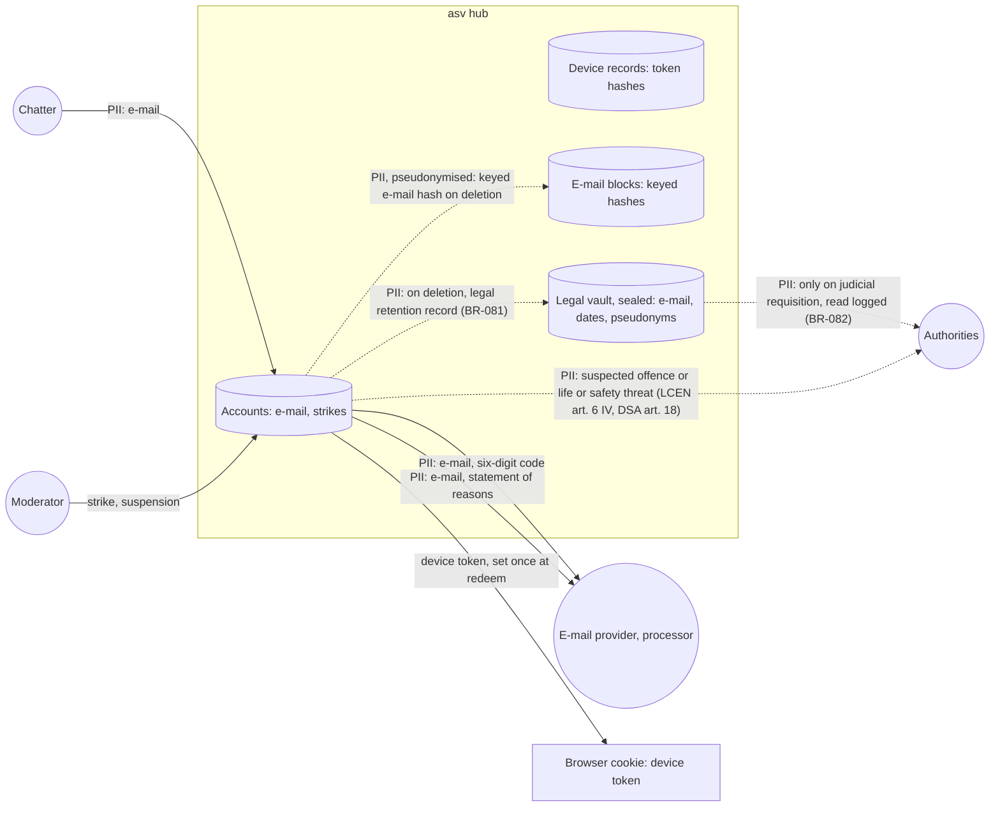

# Data-flow diagram — accounts — e-mail and sanctions

> **Feature**: accounts
> **Related**: `docs/architecture/security-and-rgpd.md` §2, ADR-0012, ADR-0013, ADR-0014

## Context

Where e-mail addresses and account data go. Does not cover reports (see `moderation`).

## Diagram

## Notes

- Other chatters never see the e-mail.
- The vault keeps the e-mail 5 years and the pseudonyms 1 year after closing (decree 2021-1362, ADR-0014).
  No domain use case reads it.
- BR-078 and BR-079 durations and the 7-day block of BR-077 are owner decisions: no binding text sets them.
