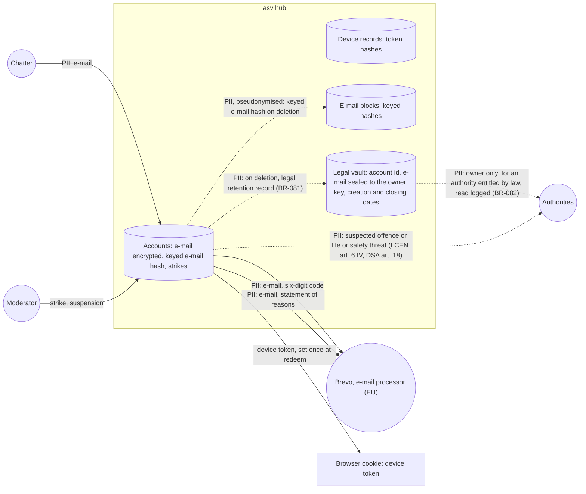

# Data-flow diagram — accounts — e-mail and sanctions

> **Feature**: accounts
> **Related**: `docs/architecture/security-and-rgpd.md` §2, ADR-0012, ADR-0013, ADR-0014, ADR-0017

## Context

Where e-mail addresses and account data go. Does not cover reports (see `moderation`).

## Diagram

## Notes

- Every stored e-mail is encrypted at application level; lookups use keyed hashes (ADR-0017). The vault
  e-mail is sealed to the owner public key: only the owner's offline private key opens it.
- Brevo receives the address and the code or statement only to deliver the mail; tracking stays off.

- Other chatters never see the e-mail.
- The vault keeps the account id 1 year and the e-mail and dates 5 years after closing (decree 2021-1362 arts. 2 and 3, ADR-0014).
  No domain use case reads it. Session pseudonyms stay only in the connection log (BR-060).
- BR-078 and BR-079 durations and the 7-day block of BR-077 are owner decisions: no binding text sets them.
