# Class diagram — accounts — domain functions, commands and effects

> **Feature**: accounts (roadmap brick 5)
> **Use cases**: UC17, UC18, UC19
> **Business rules**: BR-070 to BR-073, BR-077, BR-080, BR-081
> **Related ADRs**: ADR-0012, ADR-0013, ADR-0014, ADR-0017

## Context

The pure functions in `src/domain/accounts.ts` that the hub calls for sign-in, device claims, sign-out
and deletion. Persisted records are loaded by the hub and passed in; the functions return decisions,
the new hub state and effects, and the hub writes the stores. Strikes are only carried (brick 8 adds
them). Does not cover hashing or encryption (hub, `platform/04d`).

## Diagram

```mermaid
classDiagram
  class AccountsDomain {
    <<module>>
    +normaliseEmail(raw) String?
    +isDisposable(email) Boolean
    +decideCodeRequest(CodeRequestFacts, now, random) CodeDecision
    +checkCode(PendingCodeState, codeMatches, now) CodeCheck
    +linkAccount(state, LinkCommand, now, random) LinkResult
    +redeemDeviceClaim(state, claimHash, now, random) ClaimResult
    +unlinkSessions(state, SessionFilter) Unlinked
    +closeAccount(Account, now) Closure
    +pruneDeviceClaims(state, now) HubState
  }
  class CodeRandom {
    <<interface, extends Random>>
    +id() String
    +token() IssuedToken
    +code() String
  }
  class CodeRequestFacts {
    +String email
    +Boolean blocked
    +Number emailCodesLastHour
    +Number ipCodesLastHour
    +Date lastCodeAt
    +Number wrongTriesLastDay
  }
  class CodeDecision {
    <<union>>
    refused(reason: emailInvalid | disposable | rate)
    silent()
    issue(code, expiresAt)
  }
  class PendingCodeState {
    +Number triesLeft
    +Date expiresAt
  }
  class CodeCheck {
    <<union>>
    accepted()
    refused(reason: wrong | expired | exhausted, triesLeft)
  }
  class LinkCommand {
    +SessionId sessionId
    +String email
    +Boolean remember
    +Boolean blocked
    +Account existing
    +StrikeCarryOver carryOver
  }
  class LinkResult {
    <<union>>
    linked(state, account, created, deviceClaim?)
    refused(reason: blocked | gone)
  }
  class ClaimResult {
    <<union>>
    redeemed(state, accountId, token, expiresAt)
    refused(state)
  }
  class SessionFilter {
    <<union>>
    session(sessionId)
    device(tokenHash)
    account(accountId)
  }
  class Unlinked {
    +HubState state
    +SessionId[] unlinked
  }
  class Closure {
    +VaultRecord vault
    +StrikeCarryOver carryOver
  }
  class HubState {
    +Map~ClaimHash, DeviceClaim~ deviceClaims
  }
  class DeviceClaim {
    +AccountId accountId
    +SessionId sessionId
    +Date expiresAt
  }
  AccountsDomain ..> CodeRandom
  AccountsDomain ..> CodeDecision
  AccountsDomain ..> CodeCheck
  AccountsDomain ..> LinkResult
  AccountsDomain ..> ClaimResult
  AccountsDomain ..> Closure
  HubState *-- DeviceClaim
```

## Rules the code applies

- `normaliseEmail`: trims, lower-cases, max 254 characters, one `@`, a dot in the domain, no spaces;
  otherwise `undefined` → `refused emailInvalid`.
- `decideCodeRequest`, in this order: invalid format → `emailInvalid`; disposable domain (list in
  `src/domain/disposable-domains.ts`, BR-071) → `disposable`; `ipCodesLastHour >= 10` → `rate`;
  blocked, `emailCodesLastHour >= 3`, `lastCodeAt` less than 60 s ago or `wrongTriesLastDay >= 20` → `silent`; else `issue` with
  `random.code()` (six digits, CSPRNG in the transport) valid 10 minutes (BR-070, BR-072).
- `checkCode`: expired → `expired`; `triesLeft` already 0 → `exhausted`; no match → one try less, and the
  fifth wrong try returns `exhausted` (the hub deletes the code); match → `accepted`.
- `linkAccount`: `blocked` → `refused blocked` (BR-077, checked again at verify time); session gone →
  `refused gone`; no `existing` → a new account (`random.id()`, `verifiedAt = now`, strikes restored from
  `carryOver`, BR-080); `existing` → `lastSeenAt = now`. Sets `accountId` on the session. With `remember`,
  a device claim (`random.token()`, hash kept in `deviceClaims`, 60 s) is issued and its
  raw value returned; the hub sends `accountLinked(accountId, deviceClaim?)`.
- `redeemDeviceClaim`: an unknown or expired claim → `refused`; else the claim is removed (single use), a
  device token is issued with `random.token()`, its hash is set as `deviceTokenHash` on the session if it
  is still linked to that account, and the hub saves the device record valid 30 days (BR-073). The hub
  keeps the new state only once the device record is saved; a failed save keeps the claim and is reported.
- `unlinkSessions`: clears `accountId` and `deviceTokenHash` on every matching session, connected or
  away, and returns the new state with the unlinked session ids; the hub sends `accountUnlinked` to each
  (UC18, UC19).
- `closeAccount`: returns the vault record (account id, e-mail, `createdAt = verifiedAt`,
  `closedAt = now`, BR-081) and, when strikes are active, the carry-over with their expiry dates (BR-080).
  The hub writes the vault record before deleting the account; if the vault write fails, the account is
  not deleted and the member gets an error (same transaction in brick 9).
- Wrong-try cap (BR-072): the hub records each wrong code against the e-mail keyed hash; the count over
  24 hours feeds `wrongTriesLastDay`. A code already issued keeps its own 5 tries, so at most 24 wrong
  tries a day reach one e-mail.
