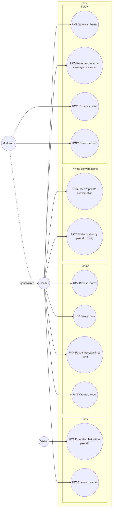

# Use case diagram — chat-core — who wants what

> **Feature**: chat-core (V1 of asv)
> **Source research**: `docs/research/caramail.md` §2 and §4
> **Related ADRs**: ADR-0004, ADR-0005, ADR-0006

## Context

Goals of the people using asv V1, grouped by domain, not by implementation. Does not cover
accounts (V2) or the technical structure (see the component diagram).

## Diagram

## Use case specs (Cockburn, short form)

**UC1 — Enter the chat with a pseudo** (planned)
- Primary actor: Visitor. Success guarantee: the visitor becomes a Chatter with a session.
- Main scenario: 1. Visitor types a pseudo, optional gender, age, city. 2. Ticks "I am 18 or older"
  and accepts the terms. 3. System checks the entry rate limit, the pseudo, the age and the ban list.
  4. System opens a session, writes a connection log and shows the room list.
- Extensions: 2a. Box not ticked or declared age under 18 → entry refused. 3a. Pseudo taken or
  invalid → system asks for another one. 3b. IP or pseudo currently banned → entry refused with the
  ban end time. 3c. Too many entry attempts from the same IP → refused for a short delay.

**UC2 — Browse rooms** (planned)
- Main scenario: 1. Chatter opens the room list. 2. System shows each room's name, kind and member count.

**UC3 — Join a room** (planned)
- Main scenario: 1. Chatter picks a room. 2. System adds them to the room presence. 3. System
  broadcasts "X joined" and sends the current member list.
- Extensions: 1a. Room full → refused.
- Alternative ending: the chatter leaves the room → system broadcasts "X left".

**UC4 — Post a message in a room** (planned)
- Main scenario: 1. Chatter types a message. 2. System checks flood limits and maximum length.
  3. System broadcasts it to the room, except to members who ignore the author.
- Extensions: 2a. Flood limit hit or message too long → message refused, chatter warned.
- Rule: smiley codes are rendered from a fixed whitelist of images. Message text is never rendered as HTML.

**UC5 — Create a room** (planned)
- A user room exists while at least one person is in it (Caramail behaviour). Its name follows the
  same length and content rules as a message and can be reported (UC9).

**UC6 — Open a private conversation** (planned)
- Main scenario: 1. Chatter clicks a pseudo in a room list or a search result and types a first
  message. 2. System opens a private window on both sides with that message.
- Extensions: 1a. Target ignores the chatter → the sender's window opens, the message is silently
  not delivered.

**UC7 — Find a chatter by pseudo or city** (planned) — plain read, no sequence diagram.

**UC8 — Ignore a chatter** (planned) — the ignored chatter's room messages and private messages are
hidden for the session.

**UC9 — Report a chatter, a message or a room** (planned) — includes a reason (harassment, minor,
spam, illegal content) and an excerpt. Required by the DSA notice-and-action rule.

**UC10 — Leave the chat** (planned)
- Main scenario: 1. Chatter clicks "leave" or closes the page. 2. System removes them from every room
  and private conversation, broadcasts "X left", frees the pseudo and closes the connection log.

**UC11 — Expel a chatter** (planned) — Moderator ends a chatter's session and bans their keyed IP
hash and pseudo for a duration.

**UC12 — Review reports** (planned) — Moderator lists open reports and closes them with an outcome.

## Notes

- "Receive a private message" is not a use case: it is the trigger of UC6 on the other side.
- Moderator is a Chatter with extra goals (actor generalization). Moderator authentication in V1
  is an open question (likely a secret moderator key, see the state diagram).
- Search by city (UC7) was the most missed feature after Caramail's redesign: keep it.
