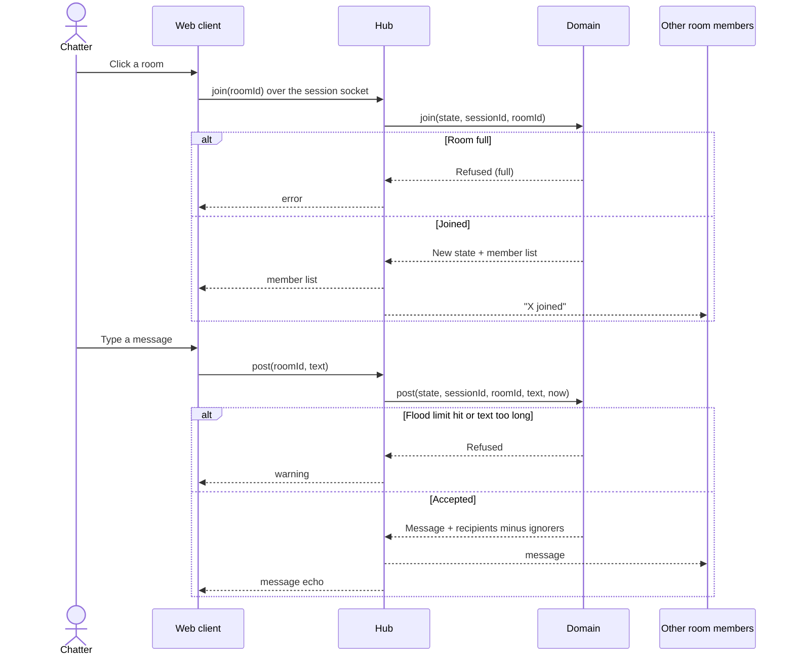

# Sequence diagram — chat-core — join a room and post

> **Feature**: chat-core
> **Use cases**: UC3 Join a room, UC4 Post a message in a room, UC8 Ignore a chatter
> **Related ADRs**: ADR-0002, ADR-0007

## Context

The chatter already has a session and its single WebSocket to the hub (UC1). Shown with the
production hub. The Node transport has the same shape with an in-memory hub. Does not cover entry.

## Diagram

## Notes

- The domain decides everything (presence, flood, length, ignore filtering). The hub only moves bytes.
- `now` is passed in so the domain stays deterministic and testable.
- No message history is stored: a newcomer only sees messages posted after joining.
