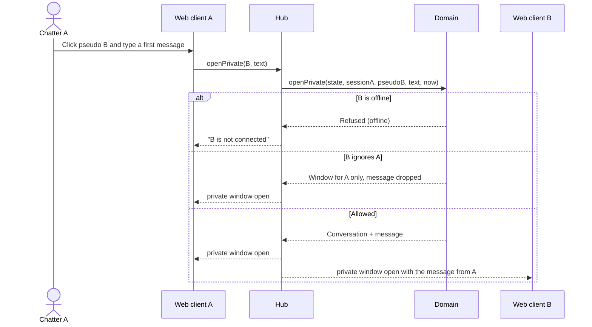

# Sequence diagram — chat-core — open a private conversation

> **Feature**: chat-core
> **Use cases**: UC6 Open a private conversation, UC8 Ignore a chatter
> **Related ADRs**: ADR-0005, ADR-0007

## Context

Both chatters are connected to the same hub through their own single socket, whatever rooms they
are in. Does not cover the following messages of the conversation, which use the same path.

## Diagram

## Notes

- An ignored chatter is not told they are ignored (Caramail behaviour, avoids escalation).
- The conversation is keyed by both session ids sorted, so A to B and B to A share it.
- The same hub serves UC7 (find by pseudo or city) from its session list.
