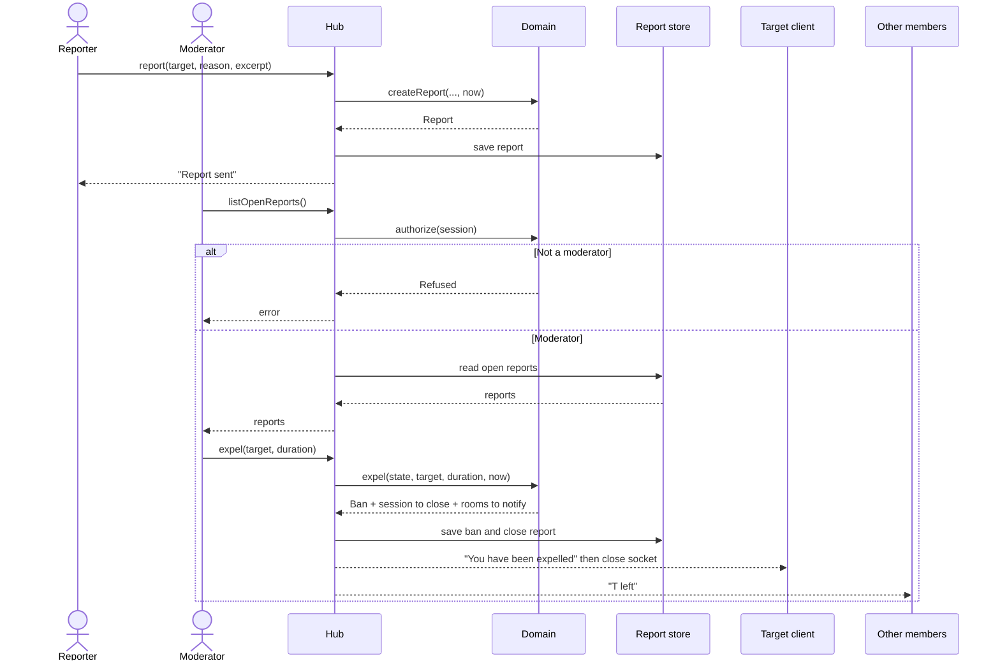

# Sequence diagram — chat-core — report and expel

> **Feature**: chat-core
> **Use cases**: UC9 Report, UC12 Review reports, UC11 Expel a chatter
> **Related ADRs**: ADR-0004, ADR-0005, ADR-0007

## Context

The DSA notice-and-action loop in its simplest form. Reports and bans are persisted through the
`ReportStore` port. Does not cover how a moderator authenticates (open question).

## Diagram

## Notes

- Reports keep a short excerpt of the reported message as evidence. It is personal data with a
  limited retention period (to be defined in the privacy notice).
- A ban targets a keyed hash of the IP and the pseudo for a duration, because V1 has no accounts (ADR-0005).
- With a single hub, expel reaches the target's only socket directly (ADR-0007).
