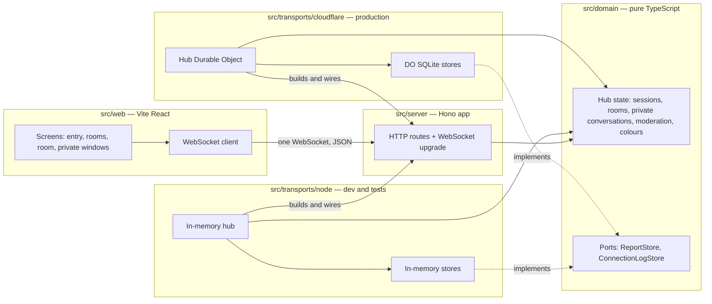

# Component diagram — chat-core — structure and dependencies

> **Feature**: chat-core
> **Related ADRs**: ADR-0002, ADR-0003, ADR-0007

## Context

Folders of the single package and the direction of dependencies. Two transports adapt the same
domain and the same server. Does not cover deployment (DNS, Workers routes) or the web screens' internals.

## Diagram

## Notes

- Every arrow into `src/domain` is inbound. The domain imports nothing from the other folders.
- The server never imports a transport. Each transport entry point builds the Hono app and plugs
  in its hub and stores (ADR-0002).
- `src/web` shares only protocol message types with the server. The `src/shared/protocol.ts` seam is
  decided in brick 2.
- Only one transport is active per runtime: Node locally, Cloudflare in production.
