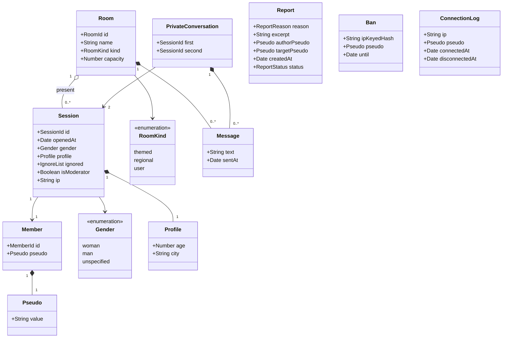

# Class diagram — chat-core — domain model

> **Feature**: chat-core
> **Related ADRs**: ADR-0004, ADR-0005, ADR-0006

## Context

Domain entities of V1. `Member` is separate from `Session` so accounts can come in V2 (ADR-0005).
Persisted records hold snapshot values, not links to ephemeral objects. Does not cover transport or
storage classes.

## Diagram

## Notes

- Pseudo colour is derived from `Session.gender` at render time, never stored.
- Declared age must be 18 or more at entry (ADR-0004).
- Messages live only in memory while the room or conversation is alive.
- `Report`, `Ban` and `ConnectionLog` are persisted and hold snapshot values only. V2 may add an
  optional `memberId` when accounts exist.
- `ConnectionLog` keeps the raw IP (legal log). `Ban` keeps an HMAC of the IP with a server secret:
  pseudonymised, not anonymised.
