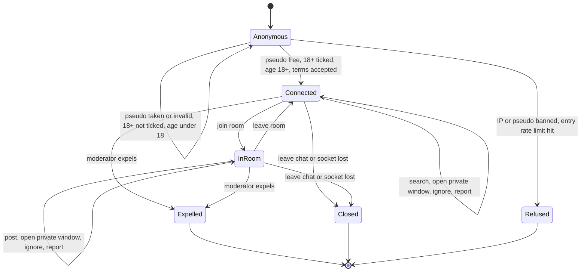

# State diagram — chat-core — session lifecycle

> **Feature**: chat-core
> **Related ADRs**: ADR-0004, ADR-0005

## Context

Lifecycle of a chatter's session, from the entry form to the end. Does not cover private windows,
which are not session states, nor a reconnection grace period (not decided yet).

## Diagram

## Notes

- A chatter in a room or not can hold several private windows at once.
- A reconnection grace period would add a `Reconnecting` state between `Connected/InRoom` and
  `Closed`. Tracked as a follow-up.
- Moderator status is `Session.isModerator`, granted at entry by a secret moderator key (open
  question for V1).
