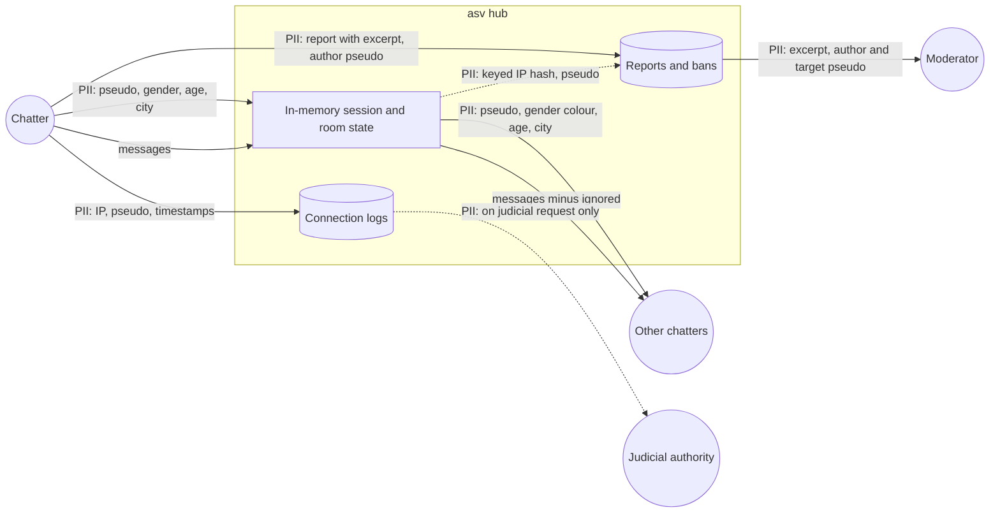

# Data-flow diagram — chat-core — personal data

> **Feature**: chat-core
> **Related ADRs**: ADR-0004, ADR-0005, ADR-0006, ADR-0007

## Context

Where personal data goes and what is persisted. Basis for the privacy notice. Does not cover
infrastructure logs kept by Cloudflare itself.

## Diagram

## Notes

- Persisted: connection logs (LCEN legal obligation, to confirm), reports and bans. Everything else
  dies with the session or the room.
- Retention periods to fix in the privacy notice: connection logs (one year reported, to confirm on
  Légifrance), reports and bans (shortest useful period).
- Gender never reaches persisted storage.
- No third-party analytics or ads (lesson from Caramail's decline).
