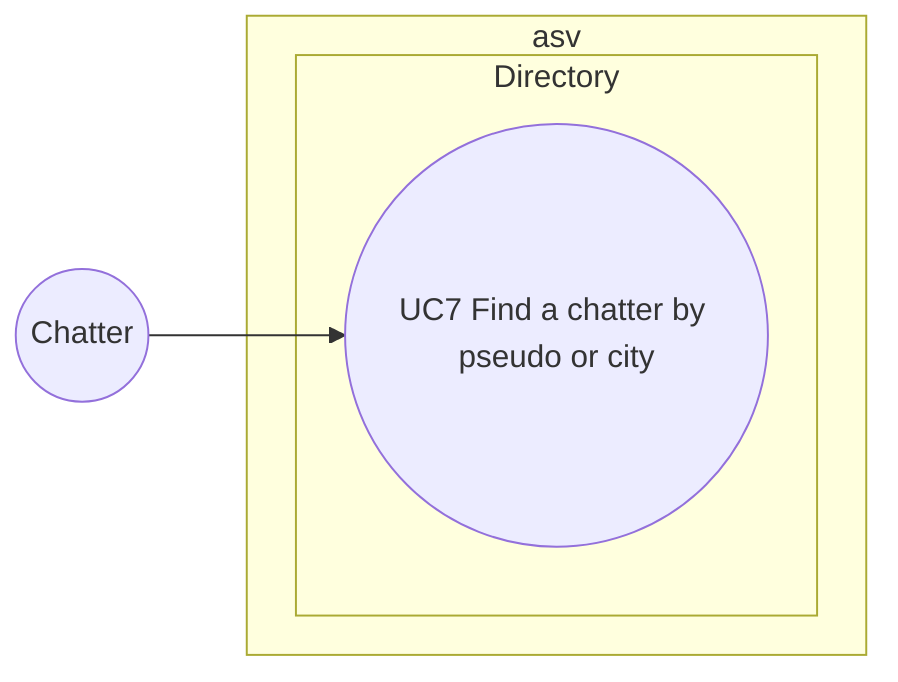

# Use case diagram — directory — find a chatter

> **Feature**: directory (roadmap brick 6)
> **Requirements**: ASV-F-004, F-009

## Context

Searching connected chatters by pseudo or city, the most missed feature after Caramail's redesign
(`docs/research/caramail.md`). A plain read: no sequence, class or state diagram is needed beyond
the `entry` model. Does not cover opening the conversation that may follow (see `private-conversations`).

## Diagram

## Use case spec

**UC7 — Find a chatter by pseudo or city** (planned)
- Main scenario: 1. Chatter types part of a pseudo or a city. 2. System returns connected and away
  chatters whose pseudo contains the text or whose city matches, case and accent insensitive, at most
  50 results. 3. Each result shows pseudo, colour, age, city, away flag and the rooms they are in.
- Extensions: 2a. Fewer than 2 characters → no search. 2b. Ignored chatters are excluded from results.
- Then the chatter may open a private conversation (UC6).

## Notes

- Searching by city exposes the declared city of every chatter. It is self-declared and optional (BR-006).
