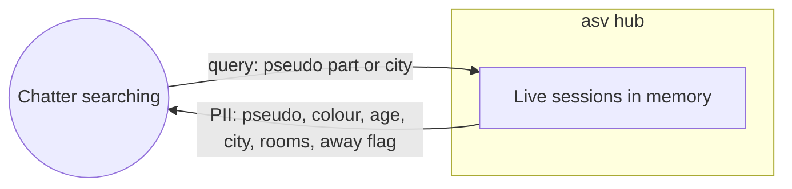

# Data-flow diagram — directory — what a search reveals

> **Feature**: directory
> **Use cases**: UC7

## Context

Personal data returned by a search. Nothing is stored. Does not cover entry data collection (see `entry`).

## Diagram

## Notes

- Queries are not logged.
- Results exclude chatters the searcher ignores.
