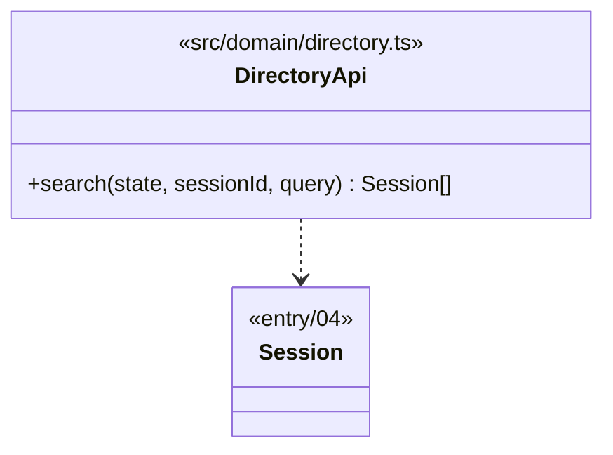

# Class diagram — directory — domain API

> **Feature**: directory (roadmap brick 6)
> **Use cases**: UC7
> **Business rules**: BR-006, BR-042
> **Related ADRs**: ADR-0011

## Context

The search function of `src/domain/directory.ts`: a pure read of the live sessions, nothing stored and
nothing logged (`directory/06`). Does not cover opening a conversation from a result (see
`private-conversations/07`).

## Diagram

## Rules the code applies

- The query is trimmed and folded like pseudos (lower case, accents removed, `pseudo.ts` `foldPseudo`).
  Fewer than 2 characters after trimming → no search, empty result (UC7 2a).
- A session matches when its folded pseudo **contains** the folded query, or when it is connected and its
  folded city **equals** the folded query. An away session has no profile (ADR-0011), so it matches by
  pseudo only.
- Excluded: the searcher, and every session `blocks(searcher, session)` (`private-conversations/07`: either
  one ignores the other, UC7 2b and BR-042).
- Sorted by folded pseudo, at most 50 hits.
- The hub maps each session to the protocol `searchResults` entry: a connected member (pseudo, gender, age,
  city, `hasAccount`) or an away chatter, plus `rooms` (the session's `rooms`).
- The search is a read: no state change, no flood count, no contribution line (it creates no content).
  Queries are never logged (`directory/06`).
