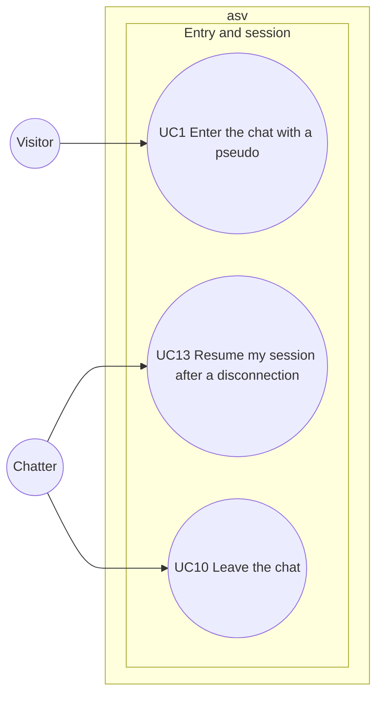

# Use case diagram — entry — enter, resume, leave

> **Feature**: entry (roadmap brick 3)
> **Requirements**: ASV-F-001, F-002, F-003, F-004, F-014, F-017
> **Business rules**: BR-001 to BR-015
> **Related ADRs**: ADR-0004, ADR-0005, ADR-0009

## Context

How a visitor becomes a chatter, survives a disconnection and leaves. Does not cover moderator
sign-in (see `moderation`).

## Diagram

## Use case specs

**UC1 — Enter the chat with a pseudo** (planned)
- Primary actor: Visitor. Stakeholders: other chatters (safe room), owner (legal log).
- Preconditions: none. Minimal guarantee: nothing is created on failure, except the attempt counter.
- Success guarantee: a session exists, a connection log is open, the room list is shown.
- Main scenario:
  1. Visitor types a pseudo, optional gender, age and optional city.
  2. Visitor ticks "I am 18 or older" and accepts the terms.
  3. System checks the entry rate (BR-007), the ban list (BR-008), the pseudo (BR-001 to BR-003) and
     the age (BR-004).
  4. System creates the member and session, opens a connection log and returns a resume token. If the
     browser presents a valid device cookie, the session is linked to that account (ADR-0013).
  5. System shows the room list.
- Extensions:
  - 2a. Box unticked or age outside 18–99 → refused (BR-004).
  - 3a. Rate exceeded → refused for 1 minute.
  - 3b. Ban active → refused with the ban end time.
  - 3c. Pseudo invalid, reserved or taken → system asks for another one.

**UC13 — Resume my session after a disconnection** (planned)
- Primary actor: Chatter whose connection dropped less than 5 minutes ago.
- Preconditions: the session is Away and the client holds its resume token.
- Success guarantee: the session is Connected again with its rooms, windows and buffered messages.
- Main scenario:
  1. The page becomes visible again or the network returns. The client reconnects and sends the token
     with its locally kept profile (ADR-0011).
  2. System checks the token, rotates it, marks the session Connected.
  3. System sends the current rooms, windows and buffered private messages, and tells others the
     chatter is back.
- Extensions:
  - 2a. Token unknown or session already closed → system shows the entry screen with the previous
    pseudo prefilled.

**UC10 — Leave the chat** (planned)
- Main scenario: 1. Chatter clicks "leave". 2. System removes the session from every room and window,
  notifies them, closes the connection log and frees the pseudo.
- Extension: 1a. Away session expires after 5 minutes → same effect without the click (BR-015).

## Notes

- "Be disconnected" is not a use case: it is a system event that leads to the Away state.
