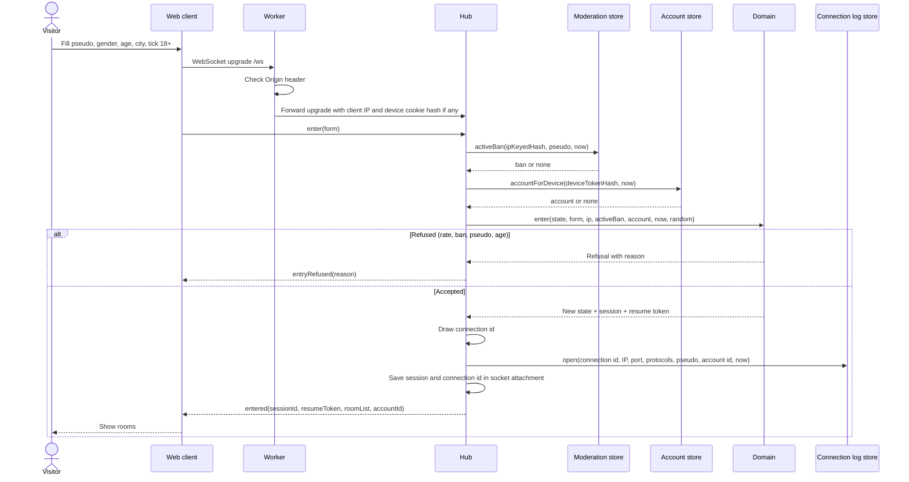

# Sequence diagram — entry — enter the chat

> **Feature**: entry
> **Use cases**: UC1
> **Business rules**: BR-001 to BR-008
> **Related ADRs**: ADR-0004, ADR-0005, ADR-0007, ADR-0011

## Context

From the entry form to the room list. Production path shown, the Node transport has the same shape
with plain function calls. Does not cover moderator sign-in (see `moderation/02c`).

## Diagram

## Notes

- `now` and `random` are passed as arguments so the domain is deterministic in tests.
- The IP comes from the platform (`CF-Connecting-IP` on Cloudflare, socket address on Node).
- The client keeps the resume token and its own profile in `sessionStorage` (ADR-0011).
- A device cookie pointing to a deleted account yields no account and `entered.staleDevice = true`.
  The client then calls `POST /account/sign-out` to clear the stale cookie (ADR-0013), since it cannot
  read the `HttpOnly` cookie itself.
- The connection line is closed by connection id on socket loss, leave and expel (see `entry/02b` and `moderation/02a`).
  Away expiry closes nothing: the line was closed when the socket was lost.
