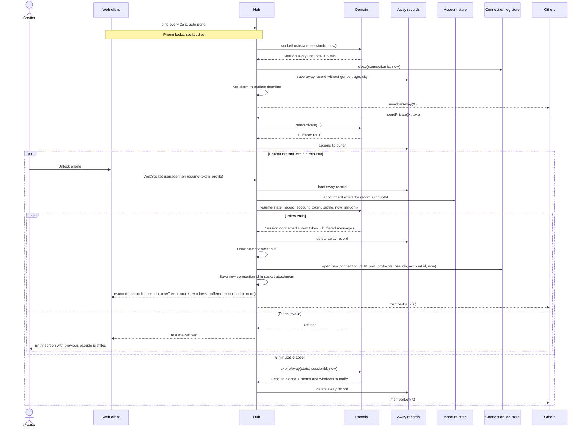

# Sequence diagram — entry — disconnect, away, resume or expire

> **Feature**: entry
> **Use cases**: UC13, UC10 extension 1a
> **Business rules**: BR-010 to BR-015
> **Related ADRs**: ADR-0009, ADR-0011

## Context

A phone locks, the socket dies, the chatter comes back within 5 minutes, or the session expires.
Does not cover the heartbeat sweep in detail (see `platform/05-state-hub`).

## Diagram

## Notes

- Room messages posted while away are not buffered (BR-013 covers private messages only).
- Gender, age and city never reach storage: the client resends them with `resume` (ADR-0011).
- UC10 (leave) follows the same closing steps as expiry, triggered by the `leave` command. It also closes the
  connection line of the current socket, since the socket is still open.
- One connection line per socket connection (BR-060): the line closes on socket loss, a resume opens a new one with
  a new connection id. The away record does not carry the id.
- If the account was deleted while away, the session resumes without it and its private windows close
  (`accountUnlinked`).
