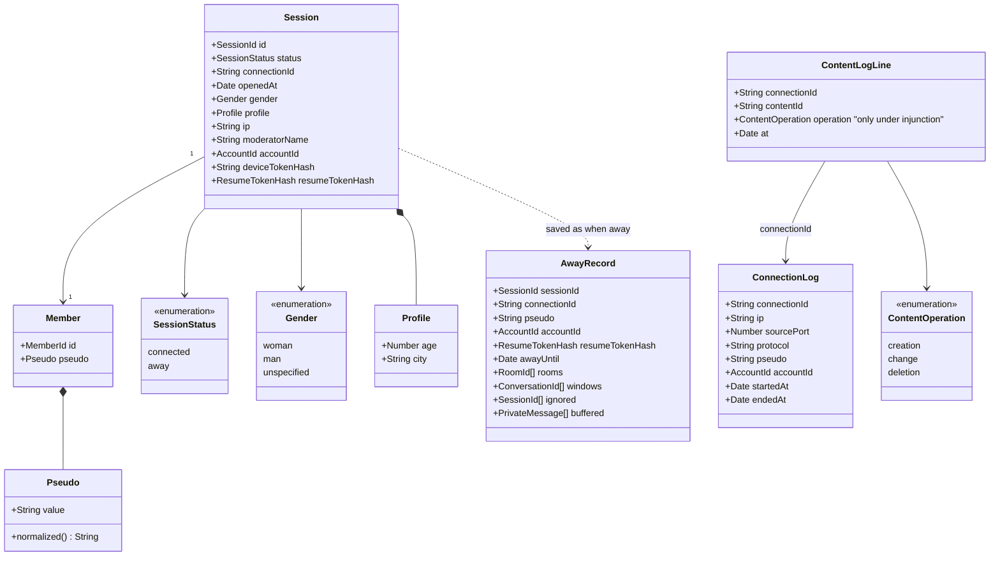

# Class diagram — entry — identity and session

> **Feature**: entry
> **Business rules**: BR-001 to BR-015, BR-060
> **Related ADRs**: ADR-0005, ADR-0006, ADR-0009, ADR-0011, ADR-0014

## Context

Entities created at entry, the away record and the legal log. Does not cover rooms, private
conversations or moderator credentials (see their studies) nor the hub aggregate (see
`platform/04b-class-hub-state`).

## Diagram

## Notes

- A session exists only once entry is accepted. Closed and expelled sessions are removed, they are not statuses.
- `moderatorName` is empty for ordinary chatters. A non-empty value means moderator rights.
- `accountId` is empty until the session is linked to an account (UC17, ADR-0012).
- `AwayRecord` holds no gender, age or city (ADR-0011). `buffered` is capped at 50 messages (BR-013).
- The resume token itself is only sent to the client. The server keeps its hash and rotates it at each resume.
- `ConnectionLog` is persisted with plain values: one line per session, with a random connection id (BR-060).
  The session, its socket attachment and its away record carry that id, so content lines and the end time
  attach to the right connection row after a rebuild or a resume (ADR-0011). The id is linked to nothing else. `sourcePort` and `accountId` are optional (empty without a port or an account).
- `ContentLogLine` is written for every creation, change or deletion (decree 2021-1362 arts. 5 and 7), never the
  content. `operation` is filled only while a Prime Minister's injunction is in force (CPCE L34-1 III, art. 6). Both logs are kept 1 year
  and read only by the owner (BR-082).
- Pseudo colour is derived from `Session.gender` in the web client.
