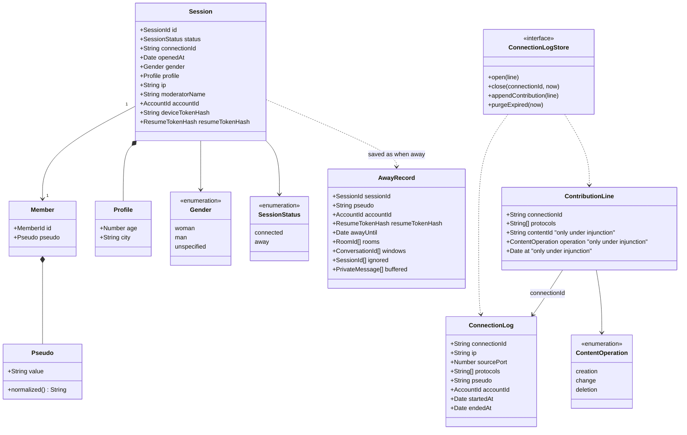

# Class diagram — entry — identity and session

> **Feature**: entry
> **Business rules**: BR-001 to BR-015, BR-060
> **Related ADRs**: ADR-0005, ADR-0006, ADR-0009, ADR-0011, ADR-0014

## Context

Entities created at entry, the away record and the legal log. Does not cover rooms, private
conversations or moderator credentials (see their studies) nor the hub aggregate (see
`platform/04b-class-hub-state`).

## Diagram

## Notes

- A session exists only once entry is accepted. Closed and expelled sessions are removed, they are not statuses.
- `moderatorName` is empty for ordinary chatters. A non-empty value means moderator rights.
- `accountId` is empty until the session is linked to an account (UC17, ADR-0012).
- `AwayRecord` holds no gender, age or city (ADR-0011). `buffered` is capped at 50 messages (BR-013).
- The resume token itself is only sent to the client. The server keeps its hash and rotates it at each resume.
- `ConnectionLog` is persisted with plain values: one line per socket connection, with a random connection id
  (BR-060). A resume draws a new connection id and opens a new line (new IP, port, protocols, pseudo, account
  id). The old line is closed when the socket is lost. `Session.connectionId` and the socket attachment hold the
  current id, so contribution lines and the end time attach to the right row after a rebuild (ADR-0011).
  `AwayRecord` does not carry it. The id is never sent to clients, never written to reports, bans or AI triage,
  and lives outside the log only in the socket attachment. `sourcePort` and `accountId` are optional (empty
  without a port or an account). The IP and port on the line are an interpretation of art. 5 2° (flagged for
  the brick 10 professional review).
- `ContributionLine` is written for every creation of a room message, private message or user room name
  (decree 2021-1362 arts. 5 2° and 7), never the content. It always holds the connection id and the protocols.
  `contentId`, `operation` and `at` are filled only while a Prime Minister's injunction is in force (CPCE L34-1 III,
  art. 6 2°). Both logs are kept 1 year and read only by the owner (BR-082).
- `ConnectionLogStore` is the port to the log table: `open` at entry or resume, `close` on socket loss, expel
  and leave, `appendContribution` before a message is delivered, `purgeExpired` in the daily run.
- Pseudo colour is derived from `Session.gender` in the web client.
