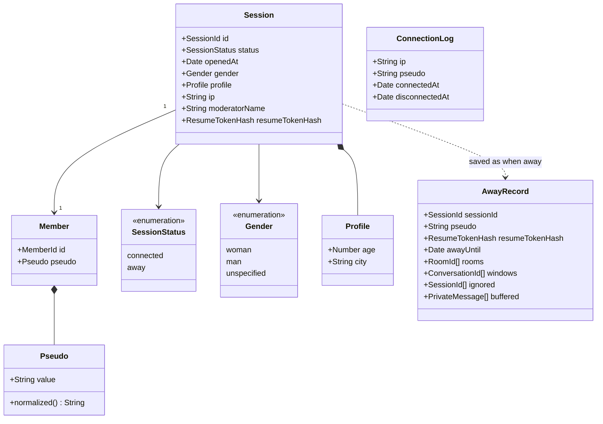

# Class diagram — entry — identity and session

> **Feature**: entry
> **Business rules**: BR-001 to BR-015
> **Related ADRs**: ADR-0005, ADR-0006, ADR-0009, ADR-0011

## Context

Entities created at entry, the away record and the legal log. Does not cover rooms, private
conversations or moderator credentials (see their studies) nor the hub aggregate (see
`platform/04b-class-hub-state`).

## Diagram

## Notes

- A session exists only once entry is accepted. Closed and expelled sessions are removed, they are not statuses.
- `moderatorName` is empty for ordinary chatters. A non-empty value means moderator rights.
- `AwayRecord` holds no gender, age or city (ADR-0011). `buffered` is capped at 50 messages (BR-013).
- The resume token itself is only sent to the client. The server keeps its hash and rotates it at each resume.
- `ConnectionLog` is persisted with plain values, no link to the ephemeral session.
- Pseudo colour is derived from `Session.gender` in the web client.
