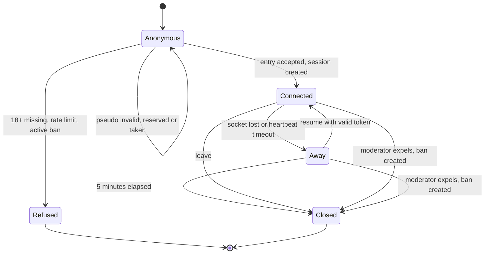

# State diagram — entry — connection and session lifecycle

> **Feature**: entry
> **Use cases**: UC1, UC10, UC11, UC13
> **Related ADRs**: ADR-0004, ADR-0005, ADR-0009

## Context

`Anonymous` and `Refused` are states of the connection before any session exists. A session is
created on `Connected`. Does not cover room membership or private windows, which are data, not states.

## Diagram

## Notes

- Closing frees the pseudo and notifies rooms and windows. The connection line closes when the socket is lost,
  on leave and on expel, not on away expiry (BR-060).
- An expulsion is a close with a ban as side effect (see `moderation/02a`).
- Moderator rights are `Session.moderatorName`, not a state (see `moderation`).
