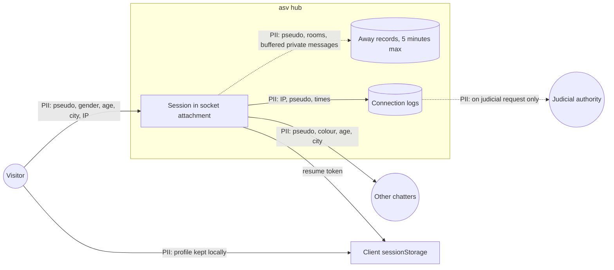

# Data-flow diagram — entry — personal data at entry and while away

> **Feature**: entry
> **Related**: `docs/architecture/security-and-rgpd.md` §2, ADR-0011

## Context

Personal data collected at entry and kept while away. Does not cover joining rooms, reports or bans
(see `rooms` and `moderation`).

## Diagram

## Notes

- Retention values: BR-060 is a legal duty (decree 2021-1362, checked 2026-10-22). BR-061 and BR-062 are owner
  decisions, no binding text sets them (GDPR art. 5(1)(e)).
- Gender, age and city stay in memory and in the client, never on server disk.
