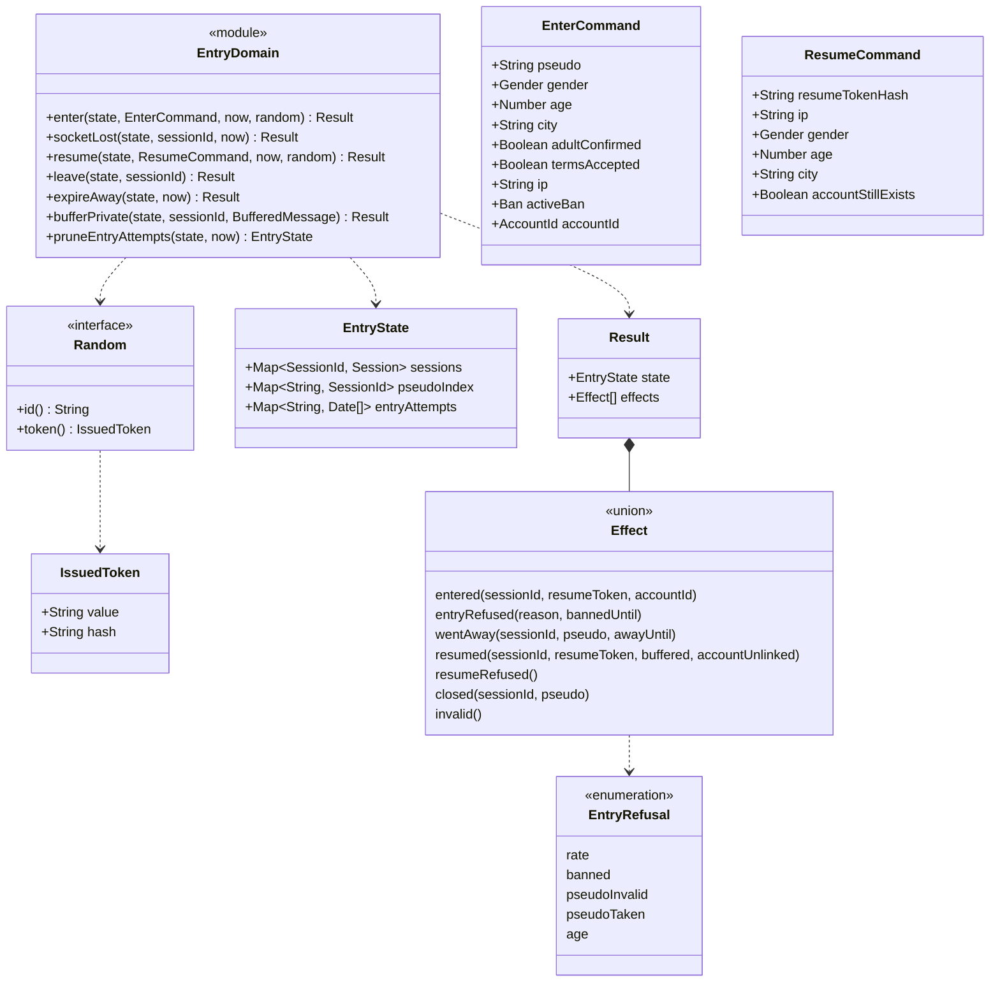

# Class diagram — entry — domain functions, commands and effects

> **Feature**: entry (roadmap brick 3)
> **Use cases**: UC1, UC10, UC13
> **Business rules**: BR-001 to BR-015
> **Related ADRs**: ADR-0002, ADR-0009, ADR-0011

## Context

The pure functions in `src/domain` that the hub calls for entry, away, resume and leave, with their
inputs, outputs and the ports they receive. Does not cover rooms (brick 4), private conversations
(brick 6) or moderator grants (brick 8): those bricks extend these types.

## Diagram

## Rules the code applies

- **Signature** (`platform/04b`): every function is pure, `(state, command, now, random) → { state, effects }`.
  It never mutates its input state, never reads a clock or a random source itself.
- **Random port**: `id()` returns a fresh session id; `token()` returns a resume token and its keyed hash,
  both drawn and computed by the hub. The domain stores only `hash` and returns `value` once in
  `entered` or `resumed` (BR-014). The hub hashes the token received with `resume` the same way and puts the
  hash in `ResumeCommand`. So the domain never hashes and never imports a crypto module.
- **Check order at entry** (UC1 step 3): rate (BR-007), ban (BR-008), pseudo format and reserved words
  (BR-001, BR-003), pseudo taken (BR-002), adult box and age (BR-004), then terms and city. First failure
  wins.
- **BR-001**: 3 to 20 characters among ASCII letters, the French letters `àâäéèêëîïôöùûüÿç` (either case),
  digits, `_`, `-`, `.`. Checked on the NFC form. No other script, so no Cyrillic or Greek look-alikes.
- **BR-002 / BR-003**: compared on the folded pseudo: NFD, diacritics removed, lower case (`Hélène` and
  `helene` are the same pseudo, `Modérateur` contains `moderateur`). A reserved word refuses the pseudo
  when it appears anywhere in it (`MonModo` refused, `pseudoInvalid`). A taken pseudo gives `pseudoTaken`.
- **BR-004**: `adultConfirmed` true and integer age 18 to 99, else `age`.
- **Terms and BR-006**: `termsAccepted` false, or a city longer than 40 characters after trimming, gives the
  `invalid` effect, mapped by the hub to the existing `error { code: "invalid" }`. An honest client never
  sends them: the entry form keeps "enter" disabled until the terms box is ticked and caps the city field at
  40 characters (`web-ui`, brick 7a). The protocol `entryRefusal` enum is unchanged. The stored city is the
  trimmed one, empty when blank.
- **BR-007**: every `enter` from an IP, accepted or refused, is recorded with `now`. Attempts older than
  60 s are dropped. If 5 attempts are already recorded in the last 60 s, the new one is refused `rate`
  (and recorded, so a client that keeps hammering stays refused). An IP keeps at most its last 5 attempts.
  `pruneEntryAttempts`, called from the hub alarm, forgets IPs with no attempt in the last minute.
- **BR-008**: the hub looks the ban up and passes it; the domain refuses `banned` with `bannedUntil` when
  `ban.until > now`.
- **BR-011 / BR-015**: `socketLost` marks the session `away` with `awayUntil = now + 5 min` and emits
  `wentAway`. `expireAway(state, now)` closes every away session whose deadline is `≤ now`, frees the pseudo
  and emits `closed` for each (the hub calls it from the alarm).
- **Session variants**: a `connected` session holds the profile, `ip` and `openedAt`; an `away` session holds
  only the ADR-0011 away record (id, pseudo, account id, token hash, `awayUntil`, buffer), so the hub can
  rebuild it from storage after hibernation. `socketLost` drops the profile and IP; `resume` takes the new
  socket's IP and opens at `now`.
- **BR-012**: an away session keeps its pseudo in `pseudoIndex` and its data, rooms included (`rooms/07`);
  windows are added by brick 6. `leave` and `expireAway` are wrapped by `hub.ts` to leave rooms.
- **BR-013**: `bufferPrivate` appends to an away session's buffer, keeping the newest 50.
- **BR-014**: `resume` finds the away session whose stored hash equals `resumeTokenHash`; otherwise
  `resumeRefused`, as is a token whose deadline has passed though the alarm has not run yet. A profile
  breaking BR-004 or BR-006 gives `invalid`. On success the profile is replaced by the one sent, a new token is drawn, the buffer is
  returned in `resumed` and emptied, the status becomes `connected`. If `accountStillExists` is false, the
  account link is removed and `resumed.accountUnlinked` is true.
- **UC10**: `leave` removes the session (connected or away), frees the pseudo and emits `closed`.
- After hibernation the hub puts away records back into the state as away sessions (`platform/04b`), so
  `resume` reads the state rather than a separate record parameter (`entry/02b` shows the record loaded
  by the hub first).
- `connectionId` is drawn by the hub and kept in the socket attachment (`entry/04`); the domain does not
  need it.
- Session ids from `Random.id()` are unique; the hub guarantees it. Raw string sizes are capped by the
  protocol layer before the domain (issue #13). City text is displayed as text only (BR-022).
- `bufferPrivate` is wired to private messages in brick 6 (`private-conversations`).
- The domain declares its own types (`Gender`, refusals, effects); it does not import
  `src/shared/protocol` (dependency rule). The hub maps effects to protocol messages.
