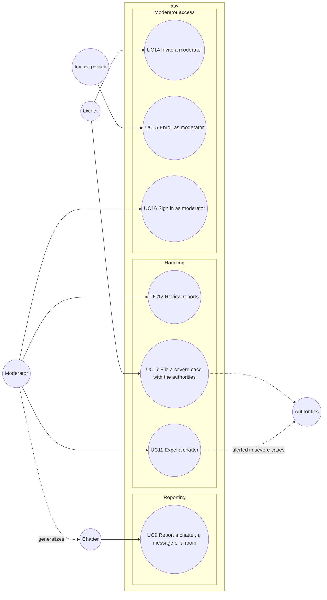

# Use case diagram — moderation — report, review, expel, moderator access

> **Feature**: moderation (roadmap brick 8)
> **Requirements**: ASV-F-011 to F-013, F-015, F-016, F-019, F-022, F-023
> **Business rules**: BR-050 to BR-057, BR-074 to BR-078, BR-091 to BR-108
> **Related ADRs**: ADR-0004, ADR-0005, ADR-0008, ADR-0010, ADR-0012, ADR-0019

## Context

The DSA notice-and-action loop, AI triage of reports, and how trusted people become moderators.
Does not cover the legal texts themselves (see `security-and-rgpd.md`).

## Diagram

## Use case specs

**UC9 — Report a chatter, a message or a room** (planned)
- Main scenario: 1. Chatter picks "report" on a pseudo, a message or a user room. 2. Chatter picks a
  reason (BR-050). The client attaches the excerpt and up to the last 20 lines the chatter saw in that
  room or window (BR-051). 3. System checks the report limit (BR-052), stores the report, asks the AI
  triage (ADR-0010) and confirms with `reportSent`.
- Extensions: 3a. Limit exceeded → `warning`. 3b. AI unavailable → report stored with urgency "unknown".

**UC12 — Review reports** (planned)
- Preconditions: session has moderator rights (BR-054).
- Main scenario: 1. Moderator opens the report list. 2. System shows open reports sorted by AI urgency,
  then date, with reason, AI summary, excerpt, context, pseudos and whether the target is still
  connected. 3. Moderator closes the report with an outcome (BR-057): no action, warned, expelled,
  suspended, room removed. A warning sends the target a `warned` message and, if the target has an
  account, adds a strike (BR-074). At the third active strike, the moderator is asked to confirm a
  7-day suspension (BR-075, sequence 02d).

**UC11 — Expel a chatter** (planned)
- Main scenario: 1. Moderator picks a target and a duration (BR-053). 2. System creates a ban on the
  keyed IP hash and the pseudo, records the moderator (BR-055), closes the target session and its
  connection log, and tells rooms and windows the target left.
- Variant: target has an account → a non-severe expel bans the keyed IP hash and pseudo only and keeps
  the account (strikes come from warnings, see 02d). The account is deleted only by a confirmed
  suspension (02d) or the severe variant below (BR-076 to BR-078).
- Variant: severe case (grooming, threats, child sexual abuse material, incitement to violence):
  1. Moderator marks the expel as severe. 2. System deletes the account at once, without strikes, and
  blocks its e-mail hash for the longer period (BR-078); a chatter without an account gets the longest
  IP and pseudo ban. 3. System sends the statement of reasons. 4. When life or safety is threatened, the
  moderator raises an authority alert (BR-104), and the owner files (UC17). Sequence 02h (brick 8c).
- Variant: remove a user room → its members get `roomClosed` (BR-106, sequence 02i).
- Closing the related report is a separate `closeReport` command.

**UC14 — Invite a moderator** (brick 8b)
- Primary actor: Owner. Main scenario: 1. Owner runs the invitation script with a moderator name and
  the owner secret. 2. System stores a hashed single-use invitation valid 24 hours (BR-056) and prints
  the link. 3. Owner sends the link by a channel of their choice.
- Extensions: 1a. Wrong or unset owner secret, non-loopback peer, or tunnel on → refused (BR-093, BR-097).
  1b. Name outside BR-094 → refused.

**UC15 — Enroll as moderator** (brick 8b)
- Main scenario: 1. Invited person opens the link. 2. System starts a passkey registration. 3. The
  device creates a passkey after its usual unlock (PIN, pattern or biometrics, no biometric data
  reaches asv). 4. System stores name, credential id and public key, and consumes the invitation.
- Extensions: 1a. Invitation expired, used or revoked → refused. 3a. Device cancelled → back to step 2.
  4a. The name already has a credential → the new one replaces it (lost device, BR-094).

**UC16 — Sign in as moderator** (brick 8b)
- Primary actor: Moderator, an enrolled person not yet in the chat.
- Main scenario: 1. Moderator picks "Moderator sign-in" on the entry screen. 2. System starts a passkey
  authentication. 3. The device signs the challenge. 4. System verifies it and returns a moderator
  grant. 5. The moderator completes the entry form (UC1) and enters with moderator rights.
- Extensions: 4a. Unknown or revoked credential, failed user verification or counter replay → refused.
  5a. Grant expired or replayed → `entryRefused(notModerator)`. 5b. Entry refused by an entry rule → the
  grant stays usable until it expires (BR-095).

**UC16i — Sign in as moderator, interim** (brick 8a, removed by 8b, #210)
- Primary actor: Owner. Main scenario: 1. Owner opens "modération" on the entry form and types the
  server token. 2. System checks it (BR-091) and enters the owner with moderator rights. Sequence 02e.
- Extensions: 2a. No token configured, tunnel on, or mismatch → refused (`entryRefused`), no session.

## Brick 8a scope (#209, 2026-11-13)

- In: UC9 without AI (urgency `unknown`), UC12 sorted oldest first (BR-092), UC11 timed expel, warn,
  third strike and suspension (02d), UC16i.
- Out, brick 8b (#210): UC14, UC15, UC16. Out, brick 8c (#211): AI triage, severe variant of UC11 and
  the authority channel, room removal, the decision e-mail to the reporter, the impact assessment.
- Behind the tester tunnel the server sends `canReport = false`, refuses `report` and refuses the
  moderator token at start (BR-091), so UC9 to UC12 stay closed to testers.
- Brick 8a is not exposed to testers before 8c: the impact assessment comes first (`security-and-rgpd.md`).

## Brick 8b scope (#210, 2026-11-13)

- In: UC14 (script + loopback route, BR-093), UC15 (enrolment page), UC16 (passkey sign-in, grant BR-095),
  revocation script, on the Node transport (`02f`, `web-ui/09`). UC16i and BR-091 are removed.
- Still closed behind the tester tunnel (BR-097).

## Notes

- The generalization means a Moderator, once signed in (UC16), has every Chatter goal too.
  UML draws it with a solid line and a hollow triangle, Mermaid cannot.
- Revoking a moderator is an owner maintenance script (`deleteModerator`).

**UC17 — File a severe case with the authorities** (brick 8c)
- Primary actor: Owner. Secondary actor: Authorities. Trigger: an authority alert e-mail (BR-104).
- Main scenario: 1. Owner opens the report in the queue. 2. Owner files through the official channel
  (`security-and-rgpd.md` §6). 3. Owner runs `pnpm mod:filed <reportId> <channel> <reference>`.
  4. System marks the alert `filed` with channel and reference.
- Extensions: 3a. Wrong secret, non-loopback peer or tunnel → refused (BR-093, BR-097). 3b. Unknown
  report or no alert → `404`.

## Brick 8c scope (#211, 2026-11-13)

- In, code PR 8c-1: AI triage of UC9 (Mistral, ADR-0019, sequence 02g), queue by urgency (BR-102), the
  impact assessment (`dpia/2026-11-13-moderation-dpia.md`). BR-092 removed.
- In, code PR 8c-2: severe variant of UC11 and the authority alert (02h, BR-103 to BR-105), UC17, room
  removal (02i, BR-106), decision e-mail to a member reporter (BR-107).
- Out: `warn` without a report stays `notAvailable`; tester exposure stays closed (BR-108).
