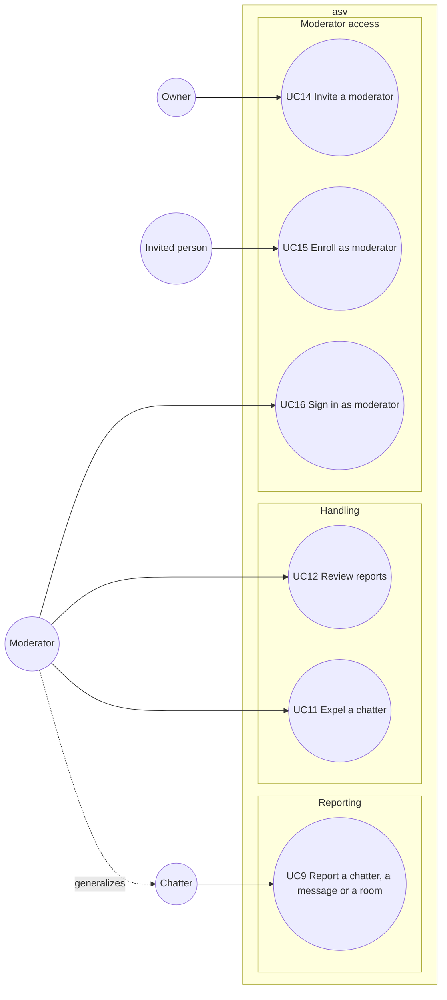

# Use case diagram — moderation — report, review, expel, moderator access

> **Feature**: moderation (roadmap brick 7)
> **Requirements**: ASV-F-011 to F-013, F-015, F-016, F-019
> **Business rules**: BR-050 to BR-057
> **Related ADRs**: ADR-0004, ADR-0005, ADR-0008, ADR-0010

## Context

The DSA notice-and-action loop, AI triage of reports, and how trusted people become moderators.
Does not cover the legal texts themselves (see `security-and-rgpd.md`).

## Diagram

## Use case specs

**UC9 — Report a chatter, a message or a room** (planned)
- Main scenario: 1. Chatter picks "report" on a pseudo, a message or a user room. 2. Chatter picks a
  reason (BR-050). The client attaches the excerpt and up to the last 20 lines the chatter saw in that
  room or window (BR-051). 3. System checks the report limit (BR-052), stores the report, asks the AI
  triage (ADR-0010) and confirms with `reportSent`.
- Extensions: 3a. Limit exceeded → `warning`. 3b. AI unavailable → report stored with urgency "unknown".

**UC12 — Review reports** (planned)
- Preconditions: session has moderator rights (BR-054).
- Main scenario: 1. Moderator opens the report list. 2. System shows open reports sorted by AI urgency,
  then date, with reason, AI summary, excerpt, context, pseudos and whether the target is still
  connected. 3. Moderator closes the report with an outcome (BR-057): no action, warned, expelled,
  room removed. A warning sends the target a `warned` message.

**UC11 — Expel a chatter** (planned)
- Main scenario: 1. Moderator picks a target and a duration (BR-053). 2. System creates a ban on the
  keyed IP hash and the pseudo, records the moderator (BR-055), closes the target session and its
  connection log, and tells rooms and windows the target left.
- Variant: remove a user room → its members get `roomClosed`.
- Closing the related report is a separate `closeReport` command.

**UC14 — Invite a moderator** (planned)
- Primary actor: Owner. Main scenario: 1. Owner runs the invitation script with a moderator name and
  the owner secret. 2. System stores a hashed single-use invitation valid 24 hours (BR-056) and prints
  the link. 3. Owner sends the link by a channel of their choice.

**UC15 — Enroll as moderator** (planned)
- Main scenario: 1. Invited person opens the link. 2. System starts a passkey registration. 3. The
  device creates a passkey after fingerprint, face or PIN. 4. System stores name, credential id and
  public key, and consumes the invitation.
- Extensions: 1a. Invitation expired or used → refused.

**UC16 — Sign in as moderator** (planned)
- Primary actor: Moderator, an enrolled person not yet in the chat.
- Main scenario: 1. Moderator picks "Moderator sign-in" on the entry screen. 2. System starts a passkey
  authentication. 3. The device signs the challenge. 4. System verifies it and returns a moderator
  grant. 5. The moderator completes the entry form (UC1) and enters with moderator rights.
- Extensions: 4a. Unknown or revoked credential → refused.

## Notes

- The generalization means a Moderator, once signed in (UC16), has every Chatter goal too.
  UML draws it with a solid line and a hollow triangle, Mermaid cannot.
- Revoking a moderator is an owner maintenance script (`deleteModerator`).
