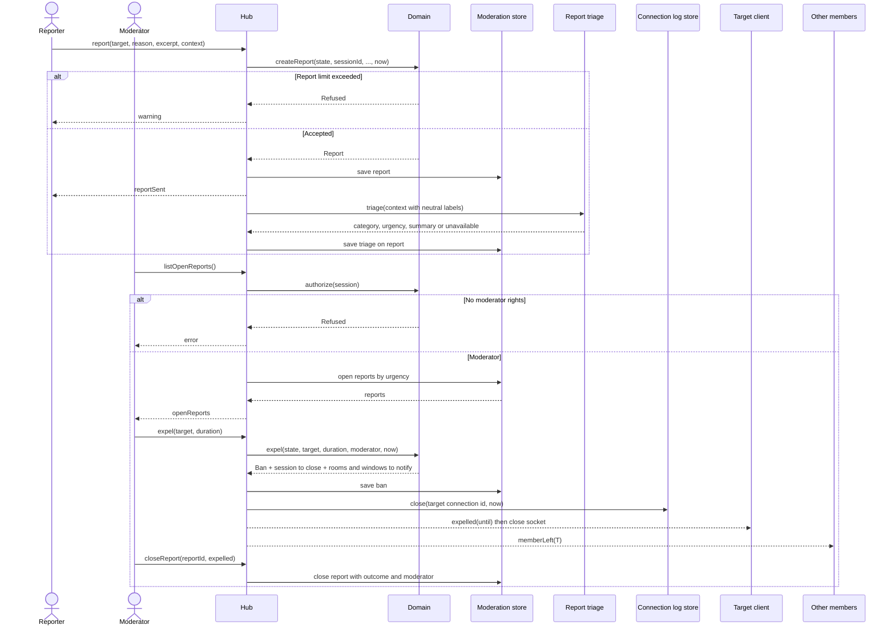

# Sequence diagram — moderation — report, triage, expel

> **Feature**: moderation
> **Use cases**: UC9, UC12, UC11
> **Business rules**: BR-050 to BR-057
> **Related ADRs**: ADR-0007, ADR-0010

## Context

From a chatter's report to the expulsion of the target. Does not cover moderator sign-in (see 02c).

## Diagram

## Notes

- Triage is asynchronous: the reporter gets `reportSent` before the AI answers.
- The AI never sanctions (ADR-0010). Pseudos are replaced by neutral labels before triage.
- The connection line is closed only if the target is connected. An away target has no open line (closed on socket loss, `entry/02b`).
- The ban key is an HMAC of the IP with a server secret: pseudonymised, not anonymised.
