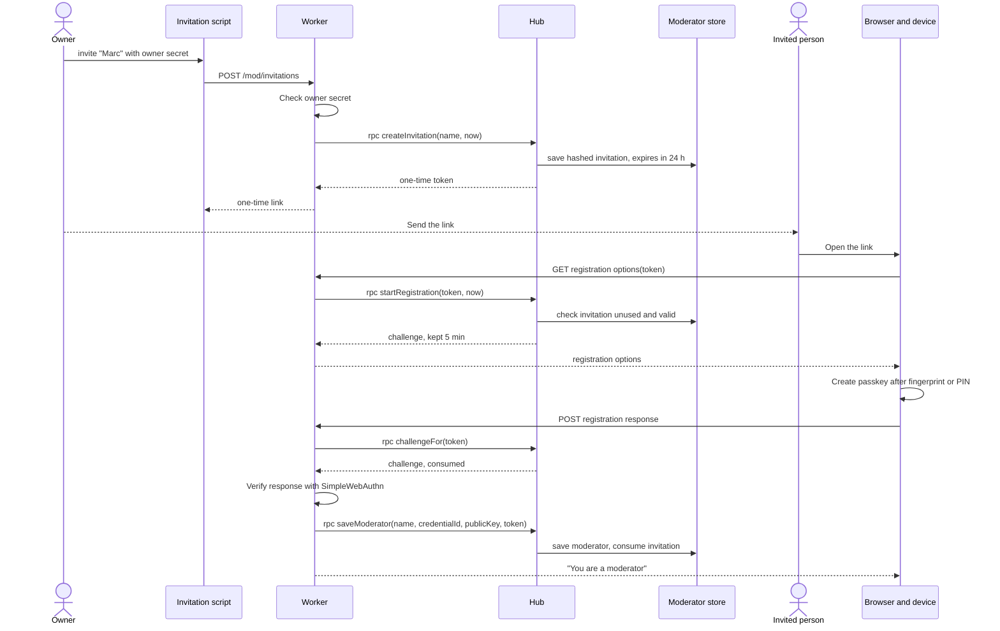

# Sequence diagram — moderation — invite and enroll a moderator

> **Feature**: moderation
> **Use cases**: UC14, UC15
> **Business rules**: BR-056
> **Related ADRs**: ADR-0008, ADR-0011

## Context

Passkey registration through a one-time invitation. The Worker runs the ceremony, the hub holds every
piece of state. Does not cover sign-in (see 02c).

## Diagram

## Notes

- Passkey ceremonies use HTTPS routes, not the chat WebSocket.
- On Node, `rpc` calls are plain method calls on the in-memory hub.
