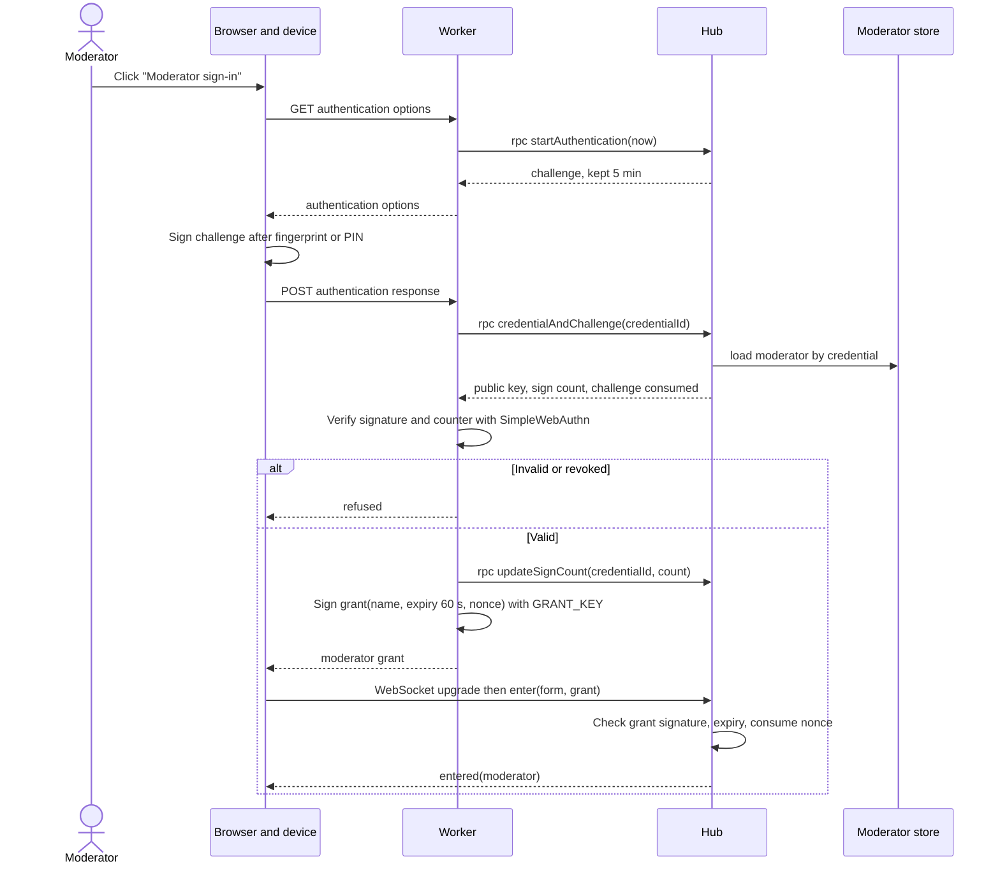

# Sequence diagram — moderation — moderator sign-in

> **Feature**: moderation
> **Use cases**: UC16, then UC1
> **Related ADRs**: ADR-0008, ADR-0011

## Context

How a moderator enters the chat with moderator rights. Does not cover enrolment (see 02b).

## Diagram

## Notes

- A grant is single use: the hub keeps consumed nonces until they expire.
- The moderator still goes through the normal entry rules (BR-001 to BR-008).
