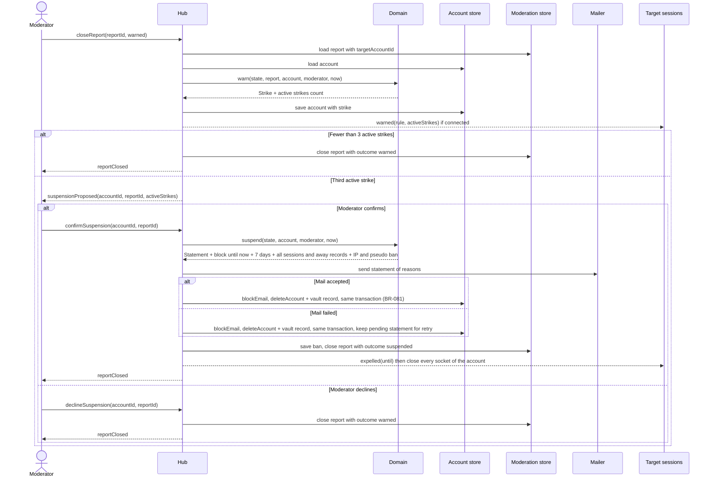

# Sequence diagram — moderation — warn, third strike, suspension

> **Feature**: moderation
> **Use cases**: UC12, UC11
> **Business rules**: BR-057, BR-074 to BR-078, BR-081
> **Related ADRs**: ADR-0012, ADR-0014

## Context

The three-strike path for a target whose report carries an account id. A target without an account can
only be expelled with a timed IP and pseudo ban (see 02a). Does not cover severe cases (see the UC11 spec).

## Diagram

## Notes

- The report is closed once the final choice is known: outcome `warned` or `suspended` (BR-057).
- If the moderator leaves before choosing, the proposal is shown again next time: it is derived from
  the active strikes, not stored (BR-075).
- The statement of reasons lists the facts, the terms clause, whether AI triage was used, and how to
  contest by replying to the contact address (DSA art. 17). It is retried until sent, for at most 7 days.
- Every account deletion, including this one, writes the legal retention record to the vault in the same
  transaction (ADR-0014). The vault holds no reason, strike or report.
- A warning itself restricts nothing, so it is notified in the chat only.
