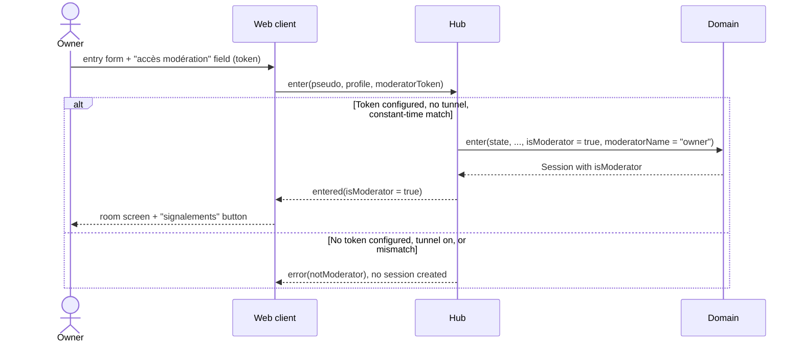

# Sequence diagram — moderation — interim moderator access (brick 8a)

> **Feature**: moderation (brick 8a, issue #209)
> **Use cases**: UC16i (interim, replaced by UC16 in brick 8b)
> **Business rules**: BR-003, BR-054, BR-055, BR-091
> **Related ADRs**: ADR-0008 (passkeys, brick 8b), ADR-0018 (tester tunnel)

## Context

Brick 8a ships reports, the queue, expel and strikes before moderator accounts exist (brick 8b, #210).
Until then the owner alone moderates, on a local server, with a server-side token. Chosen on 2026-11-13
(MCDA 420/500 against a separate `/mod` HTTP page 325 and a command-line script 365). Does not cover
passkeys, invitations or the moderator panel (02b, 02c, brick 8b).

## Diagram

## Notes

- The token comes from `ASV_MODERATOR_TOKEN` (at least 32 characters). The server refuses to start with
  `ASV_TUNNEL=1` and the token set together, so a tester never meets it (BR-091).
- The comparison is constant time on SHA-256 digests; the token is never logged nor sent back.
- Every action records the moderator name `owner` (BR-055). Brick 8b replaces this path by UC16 and
  removes the variable.
- An entry without the field is the ordinary UC1; the field is hidden behind a "modération" link so the
  entry form stays unchanged for chatters.
