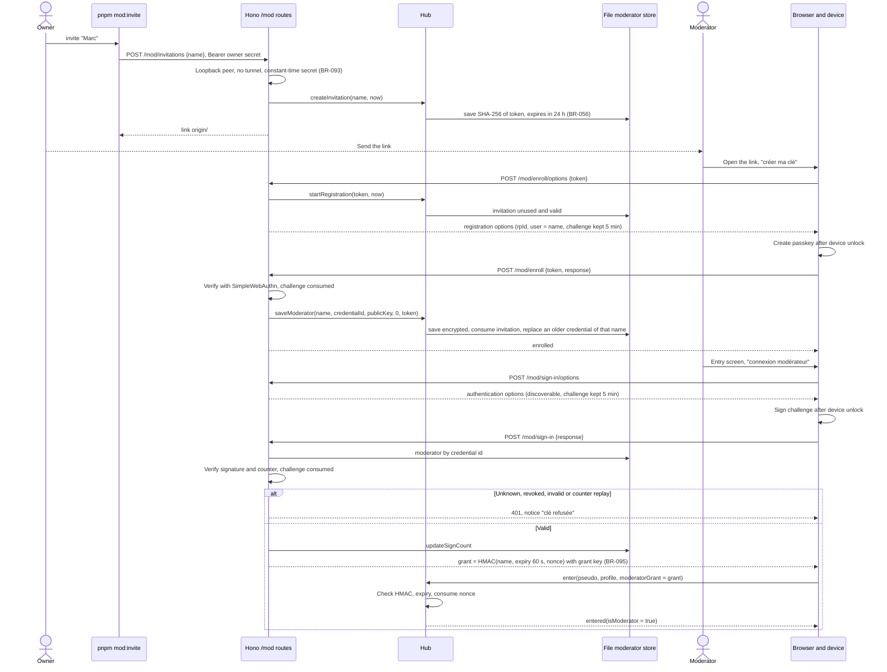

# Sequence diagram — moderation — passkeys on the Node transport (brick 8b)

> **Feature**: moderation (brick 8b, issue #210)
> **Use cases**: UC14, UC15, UC16, then UC1
> **Business rules**: BR-054, BR-055, BR-056, BR-093 to BR-097
> **Related ADRs**: ADR-0008, ADR-0017, ADR-0018

## Context

How the Node transport realises 02b and 02c before any Cloudflare deployment. The Hono app of
`src/server/app.ts` runs the ceremonies with SimpleWebAuthn and calls the in-memory hub directly, so each
`rpc` of 02b and 02c is a plain method call. Moderators and invitations live in an encrypted file (owner
choice A, 430/500, 2026-11-13); the owner creates an invitation with a script calling an HTTP route
guarded by an owner secret and limited to loopback (choice A, 440/500). Replaces the interim token of 02e.

## Diagram

## Notes

- Every `/mod/*` route answers 404 when the transport runs with `ASV_TUNNEL=1`, so testers never reach
  them before brick 8c (`01-use-case`, brick 8a scope).
- The enrolment link carries the token in the fragment, so it never reaches a server log nor a
  `Referer`; the page posts it in the body.
- The revocation script `pnpm mod:revoke <name>` calls `DELETE /mod/moderators/<name>` with the same
  guard. A session already signed in keeps its rights until it closes (ADR-0008).
- A wrong grant, an expired grant or a replayed nonce answers `entryRefused(notModerator)` with no
  session, like 02e; the rate rule of BR-091 moves to BR-096.
- Actions record the moderator name, never `owner` (BR-055).
