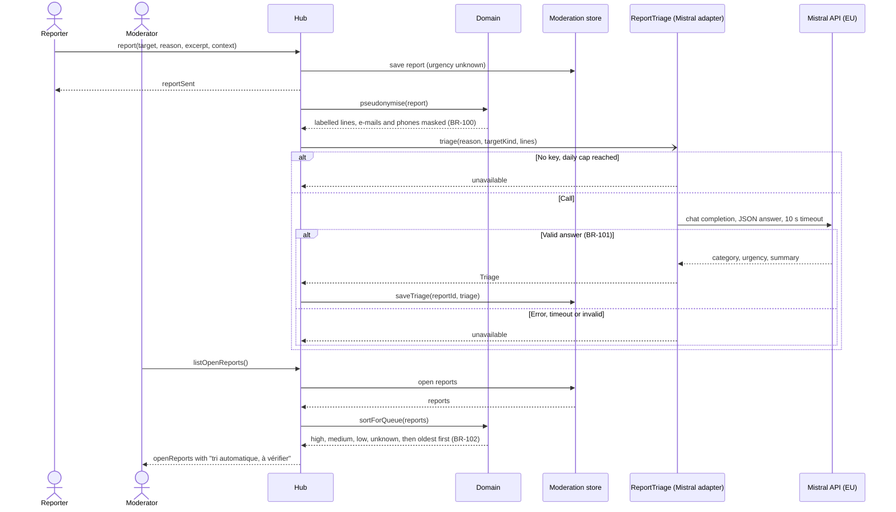

# Sequence diagram — moderation — AI triage of a report

> **Feature**: moderation (brick 8c, #211)
> **Use cases**: UC9, UC12
> **Business rules**: BR-057, BR-100 to BR-102
> **Related ADRs**: ADR-0010, ADR-0019

## Context

How a stored report gets its category, urgency and summary from the EU AI provider, and how the queue
orders it. Does not cover filing limits (see 02a).

## Diagram

## Notes

- Pseudonymisation is a pure domain function (no I/O), so it is unit-tested without the adapter.
- `unavailable` keeps the report as filed: urgency `unknown`, no summary. Nothing is retried.
- A triage arriving after the report closed is dropped (`saveTriage` ignores a closed report).
- The reported lines are untrusted input to the model: the closed schema is the only thing read back,
  and the summary is rendered as text only.
- The daily cap counter lives in hub memory and restarts at midnight UTC or on a restart.
