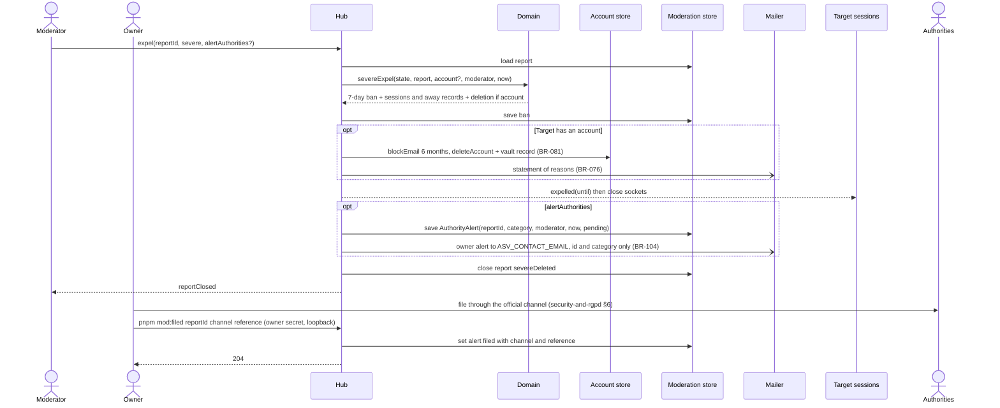

# Sequence diagram — moderation — severe expel and authority alert

> **Feature**: moderation (brick 8c, #211)
> **Use cases**: UC11 severe variant, UC17
> **Business rules**: BR-055, BR-076 to BR-078, BR-081, BR-103 to BR-105
> **Related ADRs**: ADR-0012, ADR-0014

## Context

A moderator marks a case severe, asv deletes the account and bans at once, and the owner is alerted to
file with the authorities. Does not cover the three-strike path (see 02d).

## Diagram

## Notes

- `alertAuthorities` is also accepted on `closeReport` for a non-severe outcome (BR-104), for example a
  threat by a chatter already gone.
- Write order as 02d: a failure before the deletion leaves the report open; after it, evictions and mails
  still happen and only the report close is retried (#212).
- The owner alert follows the statement-of-reasons retry (every 10 minutes, 7 days max).
- `/mod/authority-filings` answers 404 behind the tunnel (BR-097) like every `/mod` route.
