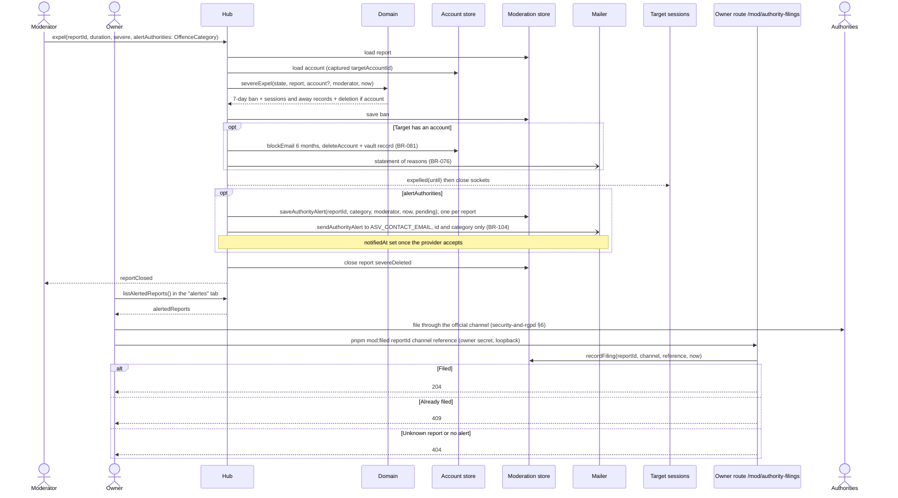

# Sequence diagram — moderation — severe expel and authority alert

> **Feature**: moderation (brick 8c, #211)
> **Use cases**: UC11 severe variant, UC20
> **Business rules**: BR-055, BR-076 to BR-078, BR-081, BR-103 to BR-105
> **Related ADRs**: ADR-0012, ADR-0014

## Context

A moderator marks a case severe, asv deletes the account and bans at once, and the owner is alerted to
file with the authorities. Does not cover the three-strike path (see 02d).

## Diagram

## Notes

- `alertAuthorities` carries an `OffenceCategory` picked by the moderator, never copied from the AI
  triage category (ADR-0010). It is also accepted on `closeReport`, `removeRoom`,
  `confirmSuspension` and `declineSuspension` (BR-104), for example a threat by a chatter already gone.
- On a severe expel the alert select starts with no value and "confirmer" stays disabled until the
  moderator picks a category or "aucune"; the server accepts `alertAuthorities` absent.
- When life is at stake the moderator who raises the alert may call 17 or 112 directly: that moderator is
  the caller (`raisedBy`, BR-055). The owner records the call with `mod:filed`, channel `17` or `112`
  and a free-text reference such as "appel 2026-11-13T22:10" (1 to 100 characters, BR-090).
- The owner is a moderator in the queue, so the "alertes" tab is the same `listAlertedReports` command
  (BR-054); filing goes through the owner route only.
- A target who deleted their own account before the decision has no account to delete and leaves no
  e-mail hash to block; only the IP and pseudo ban apply (BR-103, accepted limit).
- Write order as 02d: a failure before the deletion leaves the report open; after it, evictions and mails
  still happen and only the report close is retried (#212).
- `saveAuthorityAlert` is idempotent per report: a retried command never makes a second alert. The owner
  alert is retried like the statement of reasons (every 10 minutes, 7 days max) until `notifiedAt` is set.
- `mod:filed` takes channel in PHAROS, 17, 112, PointDeContact, and a reference of 1 to 100 characters
  following BR-090; anything else answers 400.
- `/mod/authority-filings` answers 404 behind the tunnel (BR-097) like every `/mod` route.
- Without `ASV_CONTACT_EMAIL` the Brevo adapter refuses the alert mail and logs `missing_contact_email`;
  the alert stays `pending` without `notifiedAt` and the retry round tries again for 7 days (BR-104). The
  Node server logs one loud line at start when the owner secret is set outside the tunnel and the contact
  address is missing.
