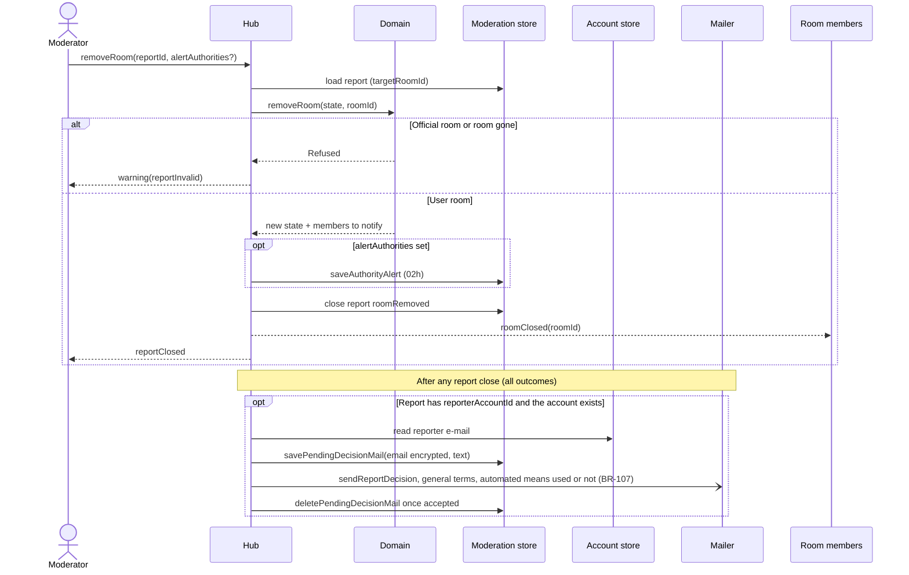

# Sequence diagram — moderation — room removal and reporter decision e-mail

> **Feature**: moderation (brick 8c, #211)
> **Use cases**: UC11 room variant, UC12
> **Business rules**: BR-057, BR-106, BR-107

## Context

Removing a reported user room, and telling a member reporter the decision on any closed report.

## Diagram

## Notes

- The decision e-mail never names the target or the sanction; it says "mesure prise" or "aucune mesure",
  whether AI triage ranked the report, and how to contest by replying to the contact address.
- The `PendingDecisionMail` keeps the address encrypted until accepted, retried every 10 minutes, 7 days
  max, like BR-076.
- The wording of the decision e-mail, and of the statements of reasons (BR-076, BR-103), lives in
  `src/server/moderation-mail.ts`; replies go to the contact address (`replyTo`).
- `declineSuspension` carries `alertAuthorities` like `confirmSuspension`: an alert picked in the proposal
  is raised whichever way the moderator answers; when the report already has one, the proposal shows it
  read-only and sends none (one alert per report, BR-104).
- Removing a room does not sanction its creator; the moderator can expel on another report.
- Open question for the brick 10 legal review: whether removing a user room created by a member needs a
  DSA art. 17 statement of reasons to that member (`security-and-rgpd.md` §5).
