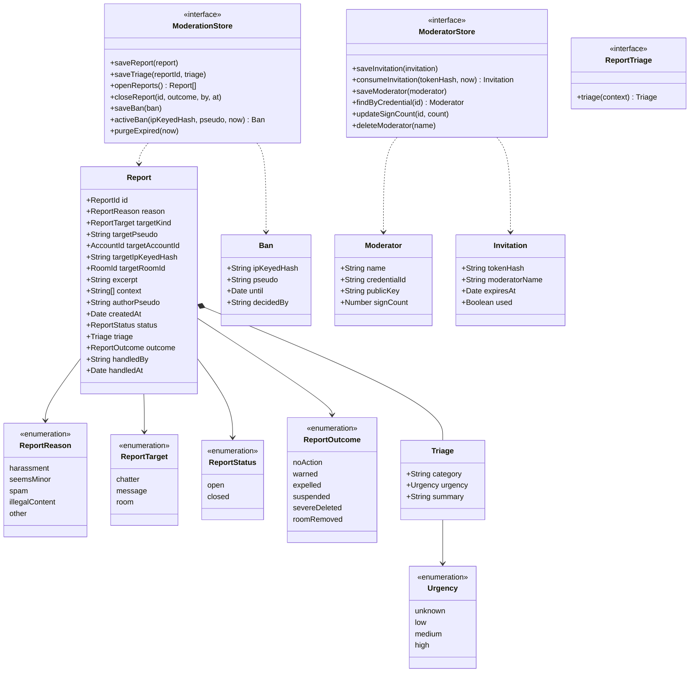

# Class diagram — moderation — reports, bans, moderators

> **Feature**: moderation
> **Business rules**: BR-050 to BR-057, BR-061, BR-062
> **Related ADRs**: ADR-0008, ADR-0010, ADR-0011

## Context

Persisted moderation records and the ports that store them. Records hold snapshot values, never links
to ephemeral sessions. Does not cover connection logs or sessions (see `entry`).

## Diagram

## Notes

- Store ports sit next to the domain, implemented in memory (Node) and in Durable Object SQLite (Cloudflare).
- `ReportTriage` wraps the third-party AI (ADR-0010). A no-AI adapter returns urgency `unknown`.
- `purgeExpired` applies BR-061 and BR-062 and is called by the hub's daily alarm (ADR-0011).
- `signCount` helps detect cloned authenticators.
- Strikes and e-mail blocks live with accounts (see `accounts/04-class`). `targetAccountId` and
  `targetIpKeyedHash` are captured when the report is filed, so a strike or a suspension ban can be
  applied after the target has left.

## Protocol (brick 8a)

The contract stays `platform/04-class-protocol`. Brick 8a uses it as follows:

- `enter.moderatorGrant` carries the interim token (BR-091); brick 8b puts the passkey grant there.
- `report` → `reportSent`; `listOpenReports` → `openReports`, each report adding `hasAccount`,
  `connected` and `activeStrikes` of its captured target.
- `expel` takes `reportId` and `duration`: it acts on the report's captured target (keyed IP hash,
  pseudo, live session if any), so the moderator never types a pseudo or an IP. `targetSessionId` is
  dropped from `expel`.
- `closeReport` with `noAction`, `warned` or `expelled`; `warned` may answer `suspensionProposed`, then
  `confirmSuspension` or `declineSuspension` (02d); every close answers `reportClosed`.
- `warn` (chat warning without a report), `removeRoom`, `expel.severe` and the outcomes `severeDeleted`
  and `roomRemoved` answer `error(invalid, notAvailable)` until brick 8c (BR-092).
- Every moderation command from a session without `isModerator` gets `error(forbidden)` (BR-054).
- Excerpt, context and pseudos of a report and the pseudo of a ban are encrypted at rest (ADR-0017);
  the keyed IP hash stays a HMAC.
