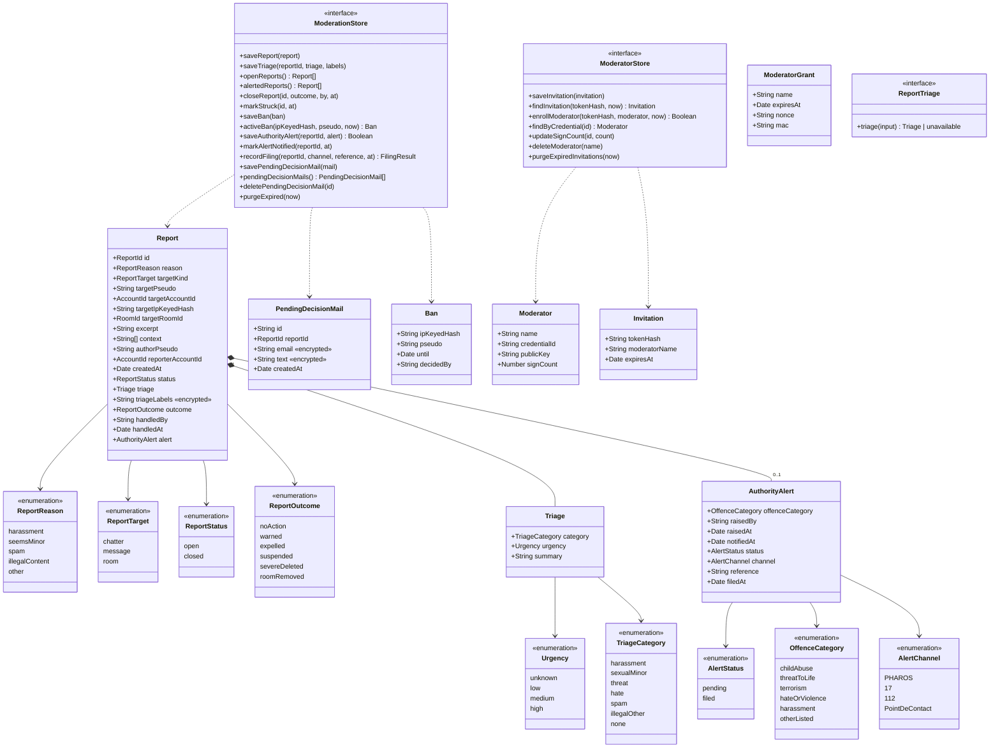

# Class diagram — moderation — reports, bans, moderators

> **Feature**: moderation
> **Business rules**: BR-050 to BR-057, BR-061, BR-062, BR-100 to BR-107
> **Related ADRs**: ADR-0008, ADR-0010, ADR-0011, ADR-0019

## Context

Persisted moderation records and the ports that store them. Records hold snapshot values, never links
to ephemeral sessions. Does not cover connection logs or sessions (see `entry`).

## Diagram

## Notes

- Store ports sit next to the domain, implemented in memory (Node) and in Durable Object SQLite (Cloudflare).
- `ReportTriage` wraps the third-party AI (ADR-0010). A no-AI adapter returns urgency `unknown`.
- `purgeExpired` applies BR-061 and BR-062 and is called by the hub's daily alarm (ADR-0011).
- `signCount` helps detect cloned authenticators.
- Strikes and e-mail blocks live with accounts (see `accounts/04-class`). `targetAccountId` and
  `targetIpKeyedHash` are captured when the report is filed, so a strike or a suspension ban can be
  applied after the target has left.

## Protocol (brick 8a)

The contract stays `platform/04-class-protocol`. Brick 8a uses it as follows:

- `enter.moderatorGrant` carries the interim token (BR-091); brick 8b puts the passkey grant there (BR-095).
- `report` → `reportSent`; `listOpenReports` → `openReports`, each report adding `hasAccount`,
  `connected` and `activeStrikes` of its captured target.
- `expel` takes `reportId` and `duration`: it acts on the report's captured target (keyed IP hash,
  pseudo, live session if any), so the moderator never types a pseudo or an IP. `targetSessionId` is
  dropped from `expel`.
- `closeReport` with `noAction` or `warned`; outcome `expelled` is set by `expel` only, so
  `closeReport(expelled)` answers `error(invalid, notAvailable)`. `warned` may answer
  `suspensionProposed`, then `confirmSuspension` or `declineSuspension` (02d); every close answers
  `reportClosed`. One report gives one strike at most (BR-074): the store keeps `struckAt`, and a
  second `warned` on a struck report only proposes the suspension again (or closes it below three
  strikes). `openReports` items carry `struck`. `declineSuspension` needs a struck report of that account.
- `expel` and `warned` on a room report answer `warning(reportInvalid)`.
- `entered` and `resumed` carry `canReport`: false behind the tester tunnel, where `report` answers
  `error(invalid, notAvailable)` and the client hides every report entry point (`01-use-case`).
- `warn` (chat warning without a report), `removeRoom`, `expel.severe` and the outcomes `severeDeleted`
  and `roomRemoved` answered `error(invalid, notAvailable)` in brick 8a (BR-092, removed); brick 8c
  opens all but `warn`.
- Every moderation command from a session without `isModerator` gets `error(forbidden)` (BR-054).
- Excerpt, context and pseudos of a report are encrypted at rest (ADR-0017). A ban keeps only keyed
  hashes (HMAC) of the IP and of the folded pseudo, so the entry check compares hashes and never
  decrypts.
- `resumed.isModerator` carries the rights back to a moderator session after a resume (BR-095 since brick 8b).

## Brick 8b (#210)

- `ModeratorStore` gets two adapters on Node: in memory for tests, and an encrypted file
  (`ASV_MODERATOR_FILE`, BR-099). `findInvitation` reads an unexpired invitation without consuming it
  (registration options); `enrollModerator` deletes it and saves the moderator in one write, so a failed
  write changes neither; `deleteModerator` also deletes that name's invitations (BR-094).
  `purgeExpiredInvitations` runs with the daily purge of the legal files on the Node transport.
- `ModeratorGrant` is not stored: it is built and checked by `moderator-grant.ts`.
- `src/server/moderator-grant.ts` (BR-095) replaces `moderator-token.ts`. `enter.moderatorGrant` carries its serialised form.
- The WebAuthn ceremonies sit in `src/server/moderator-routes.ts`, the only module importing
  `@simplewebauthn/server`; the web client uses `@simplewebauthn/browser`.

## Brick 8c (#211)

- `ReportTriage.triage` takes `{reason, targetKind, lines}` already pseudonymised by the domain (BR-100)
  and resolves a `Triage` or `unavailable`; adapters: no-AI (unchanged) and Mistral (ADR-0019, BR-101).
- `saveTriage` ignores a closed report and stores the label map (`[A]` → pseudo) encrypted with the
  triage (BR-100). `purgeExpired` keeps a report with an alert 1 year (BR-061, BR-105).
- `alertedReports` lists closed reports whose alert is `pending` or `filed`, until purge; `openReports`
  lists open reports only.
- `saveAuthorityAlert` is idempotent: one alert per report, a second call returns `false` and changes
  nothing. `markAlertNotified` sets `notifiedAt` once the owner alert is accepted; until then the hub
  tick retries it (BR-104). `recordFiling` returns `filed`, `alreadyFiled` (409) or `noAlert` (404).
- `PendingDecisionMail` mirrors `PendingStatement` (`accounts/04`): kept until the mailer accepts the
  decision e-mail, 7 days max (BR-107).
- `OffenceCategory` matches the rows of `security-and-rgpd.md` §6 and is always the moderator's choice,
  never copied from `TriageCategory` (ADR-0010).
- `Mailer` gains `sendAuthorityAlert(reportId, category)` and `sendReportDecision(email, decision)`
  (`accounts/04`), both resolving `true` only when the provider accepted the mail, retried like BR-076.
- Protocol: `expel` gains `severe` and `alertAuthorities?: OffenceCategory`; `closeReport`, `removeRoom`
  and `confirmSuspension` gain `alertAuthorities?`; `removeRoom(reportId)` answers `reportClosed` or
  `warning(reportInvalid)`; `openReports` items gain `triage` (with the label legend) and `alert`;
  `listAlertedReports` answers `alertedReports`. Outcomes `severeDeleted` and `roomRemoved` become
  available.
- Owner route `POST /mod/authority-filings` (BR-093 guard, BR-097) and script `pnpm mod:filed`.
