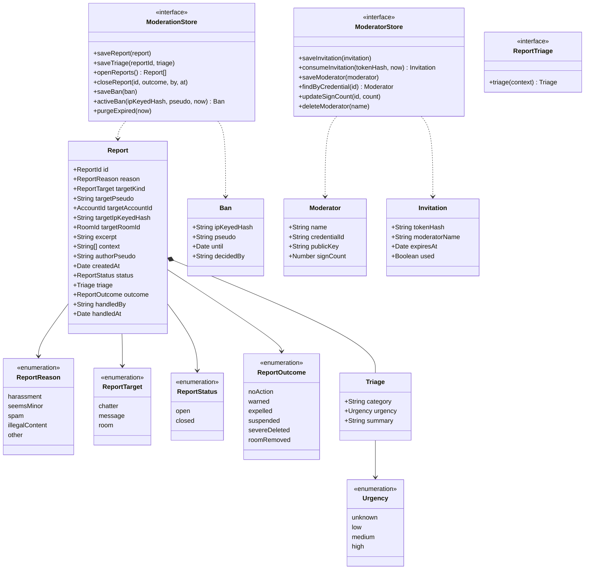

# Class diagram — moderation — reports, bans, moderators

> **Feature**: moderation
> **Business rules**: BR-050 to BR-057, BR-061, BR-062
> **Related ADRs**: ADR-0008, ADR-0010, ADR-0011

## Context

Persisted moderation records and the ports that store them. Records hold snapshot values, never links
to ephemeral sessions. Does not cover connection logs or sessions (see `entry`).

## Diagram

## Notes

- Store ports sit next to the domain, implemented in memory (Node) and in Durable Object SQLite (Cloudflare).
- `ReportTriage` wraps the third-party AI (ADR-0010). A no-AI adapter returns urgency `unknown`.
- `purgeExpired` applies BR-061 and BR-062 and is called by the hub's daily alarm (ADR-0011).
- `signCount` helps detect cloned authenticators.
- Strikes and e-mail blocks live with accounts (see `accounts/04-class`). `targetAccountId` and
  `targetIpKeyedHash` are captured when the report is filed, so a strike or a suspension ban can be
  applied after the target has left.

## Protocol (brick 8a)

| Direction | Message | Payload | Rule |
|---|---|---|---|
| client → server | `enter` | adds optional `moderatorToken` | BR-091 |
| client → server | `report` | `targetKind`, `targetPseudo`, `roomId` or private window, `reason`, `excerpt` ≤ 500, `context` ≤ 20 lines | BR-050 to BR-052 |
| server → client | `reportSent` | `reportId` | UC9 |
| client → server | `listOpenReports` | — | BR-054 |
| server → client | `openReports` | reports with `hasAccount`, `connected`, `activeStrikes` | BR-092 |
| client → server | `expel` | `reportId`, `duration` (`1h`, `24h`, `7d`) | BR-053, BR-055 |
| server → client | `expelled` | `until` | BR-008 |
| client → server | `closeReport` | `reportId`, `outcome` (`noAction`, `warned`, `expelled`) | BR-057 |
| server → client | `warned` | `reason`, `activeStrikes` | BR-074 |
| server → client | `suspensionProposed` | `reportId`, `activeStrikes` | BR-075 |
| client → server | `confirmSuspension` / `declineSuspension` | `reportId` | BR-075 to BR-077 |
| server → client | `reportClosed` | `reportId`, `outcome` | BR-057 |

- Every moderation command from a session without `isModerator` gets `error(notModerator)` (BR-054).
- Excerpt, context and pseudos of a report and the pseudo of a ban are encrypted at rest (ADR-0017);
  the keyed IP hash stays a HMAC.
- `expel` targets the report's captured target, so the moderator never types a pseudo or an IP.

