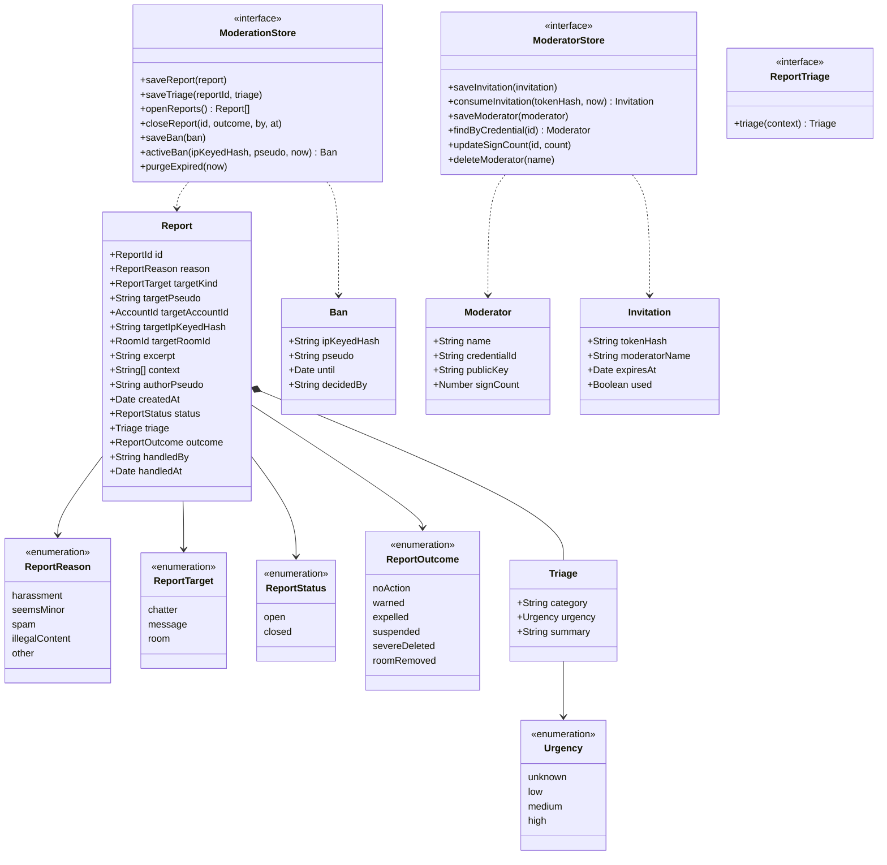

# Class diagram — moderation — reports, bans, moderators

> **Feature**: moderation
> **Business rules**: BR-050 to BR-057, BR-061, BR-062
> **Related ADRs**: ADR-0008, ADR-0010, ADR-0011

## Context

Persisted moderation records and the ports that store them. Records hold snapshot values, never links
to ephemeral sessions. Does not cover connection logs or sessions (see `entry`).

## Diagram

## Notes

- Store ports sit next to the domain, implemented in memory (Node) and in Durable Object SQLite (Cloudflare).
- `ReportTriage` wraps the third-party AI (ADR-0010). A no-AI adapter returns urgency `unknown`.
- `purgeExpired` applies BR-061 and BR-062 and is called by the hub's daily alarm (ADR-0011).
- `signCount` helps detect cloned authenticators.
- Strikes and e-mail blocks live with accounts (see `accounts/04-class`). `targetAccountId` and
  `targetIpKeyedHash` are captured when the report is filed, so a strike or a suspension ban can be
  applied after the target has left.
