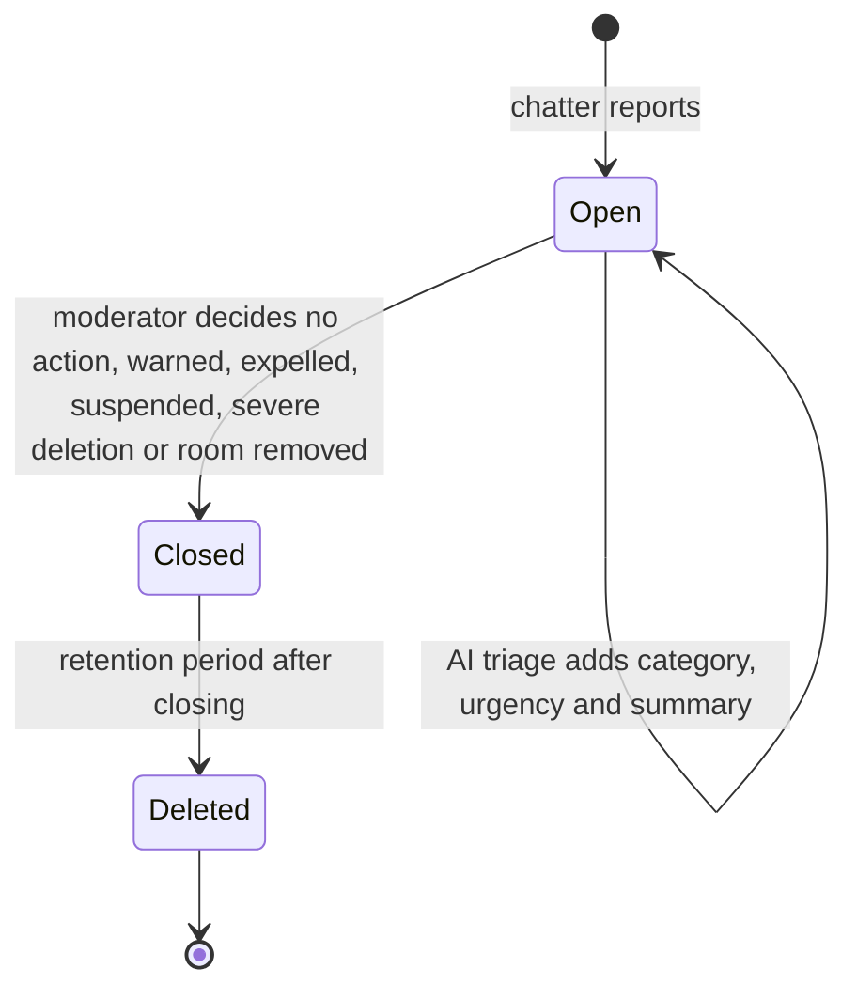

# State diagram — moderation — report lifecycle

> **Feature**: moderation
> **Use cases**: UC9, UC12, UC11
> **Business rules**: BR-057, BR-061

## Context

Lifecycle of a report, from filing to deletion. Does not cover bans, which simply expire.

## Diagram

## Notes

- An open report is never deleted automatically: every report gets a human decision. This follows the
  DSA notice-and-action duty (art. 16(6), checked 2026-10-22, see `security-and-rgpd.md`).
- The 6-month retention (BR-061) is an owner decision: no binding text sets it.
