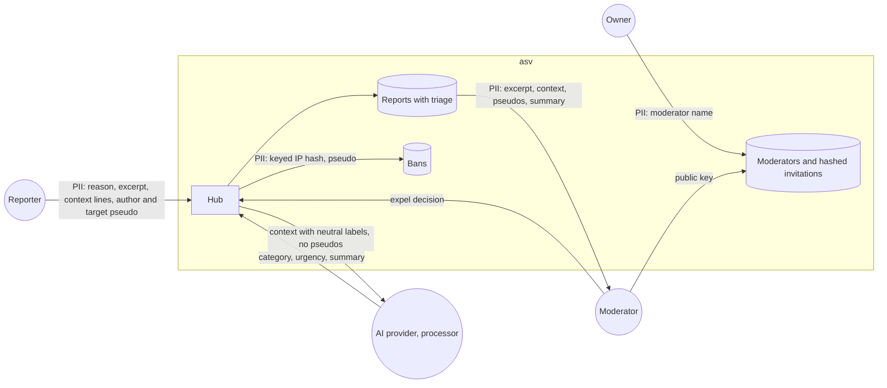

# Data-flow diagram — moderation — persisted moderation data

> **Feature**: moderation
> **Related**: `docs/architecture/security-and-rgpd.md` §2, ADR-0010

## Context

Personal data in reports, AI triage, bans and moderator credentials. Does not cover connection logs
(see `entry`).

## Diagram

## Notes

- Moderator credentials hold no secret: the private key never leaves the moderator's device.
- Message content can still identify people even without pseudos: the AI provider needs a processing
  agreement and EU processing is preferred (ADR-0010).
- Retention values are proposals until the brick 9 legal check (BR-060 to BR-062).
