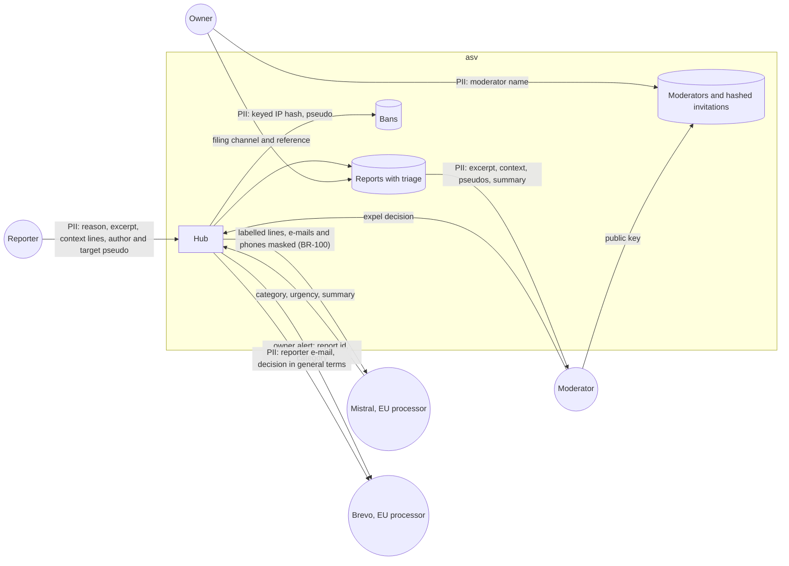

# Data-flow diagram — moderation — persisted moderation data

> **Feature**: moderation
> **Related**: `docs/architecture/security-and-rgpd.md` §2, ADR-0010

## Context

Personal data in reports, AI triage, bans and moderator credentials. Does not cover connection logs
(see `entry`).

## Diagram

## Notes

- Moderator credentials hold no secret: the private key never leaves the moderator's device.
- Message content can still identify people even without pseudos: the AI provider needs a processing
  agreement and EU processing is preferred (ADR-0010).
- Retention values: BR-060 is a legal duty (decree 2021-1362, checked 2026-10-22). BR-061 and BR-062 are owner
  decisions, no binding text sets them (GDPR art. 5(1)(e)).
- Brick 8b (#210): the moderator store is the encrypted file `ASV_MODERATOR_FILE` of the Node transport
  (BR-099): names, credential ids, public keys and hashed invitations; the owner script writes through
  the loopback route (BR-093).
- Brick 8a (#209): no flow to the AI provider and no moderator store yet; reports and bans are
  encrypted at rest (ADR-0017) in an in-memory store of the Node transport, lost at restart until a
  file or database store lands (8b).
- Brick 8c (#211): the AI flow goes live with Mistral (ADR-0019); impact assessment
  `dpia/2026-11-13-moderation-dpia.md`.
